# Software Requirements Specification

## DecisionTrace — Decision, Commitment & Dependency Traceability System

**Team:** Course Project 8
**Members:** 王耀增 (2451393), 农国达 (2453193), 李灏文 (2453192), 陈昊宗 (2453197)
**Course:** System Analysis and Design — Group Project, Assignment 1, Part I
**Date:** 2026-10-23

---

## 1. Table of Contents

1. Table of Contents
2. Introduction *(400–800 words — refined from proposal)*
3. Strategic Analysis — SWOT/TOWS, business goals and initiatives
4. Roadmap — agile/MVP roadmap with timeline and milestones
5. Use Case and Business Process Modelling
6. Glossary
7. Supplementary Specification (Non-Functional Requirements)
8. UI Mockups
9. References
10. Team Member Contributions
11. AI Tools Reflection

---

## 2. Introduction

### 2.1 What this system is

DecisionTrace is a lightweight web system that keeps a team's decisions traceable: not just *what* was decided, but *why*, *who committed to what*, *how the work items depend on each other*, and *what breaks when something changes*. Teams record a small set of structured items — discussions, decisions, commitments and dependencies — and the system links them into one connected history.

### 2.2 The problem

Real project information is born in meetings and chats. Consider a typical exchange:

> "We'll use PostgreSQL because payment transactions need transaction support. Carol will finish the schema by Friday. Bob starts the API once the schema is ready."

At that moment everyone understands the reasoning. Two weeks later Carol is delayed; a month later someone proposes switching to MongoDB. Now the team has to reconstruct: why PostgreSQL? who promised what? which tasks sit downstream of the schema? A task tracker stores Carol's and Bob's tasks, but not the reasoning or the dependency between them. Meeting notes store words, but not the links between decisions and work.

Existing tools each cover part of this. Task tools manage owners and deadlines; meeting assistants transcribe and summarize; wikis keep long-form knowledge; ADR-style tools record decisions. None of them maintains the *relationships across* these layers as the project moves on.

### 2.3 Our core idea: the decision graph

The center of DecisionTrace is a **directed graph over project records**:

- **Nodes:** Discussions, Decisions, Commitments (and later, Changes)
- **Edges:** a Discussion *produces* a Decision; a Decision *creates* Commitments; a Commitment *BLOCKS* another Commitment; a Change *supersedes* a Decision

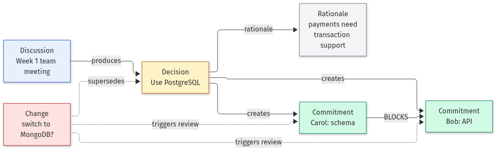

Treating the records as a graph changes what the system can answer. The dependency edges form a partial order over the work: a **topological order** shows which commitments can start right now and which are held up by upstream work. **Cycle detection** turns a circular dependency (A blocks B, B blocks A) from an invisible deadlock into an explicit warning. When a commitment becomes DELAYED, the impact is not a guess — it is the set of nodes reachable from it along BLOCKS edges.

This is also what a good meeting summary should be: not a bullet list, but a **graph snapshot** — what was said, what was decided, who committed, and how those pieces connect to the rest of the project.

### 2.4 AI-assisted, human-confirmed

Meetings produce unstructured text, and building the graph by hand is tedious. An LLM can propose candidate nodes and edges from a discussion, and the system routes every proposal through a Confirm / Edit / Reject review before it enters the graph. AI output is never authoritative on its own, and the audit trail records who confirmed what. AI handles the extraction; humans stay responsible for project facts.

### 2.5 Target users

- **Team leads / project managers** of small software teams (roughly 3–15 people): run meetings, assign work, and need to answer "why" and "what if" questions.
- **Team members**: review what they are on the hook for, confirm their own commitments, and report status.
- **New joiners**: need to understand how past decisions were reached, fast.

Explicit usability goals for these users are given in Section 7.1.

### 2.6 Scope and status

DecisionTrace does not replace task trackers, chat or wikis. It is the missing relationship layer between them. The current prototype (React + FastAPI + SQLite) already demonstrates the PostgreSQL/Carol/Bob scenario end-to-end: a decision with rationale, two commitments, a BLOCKS dependency, a delay, automatic impact detection and an audit trail. The graph view, topological ordering, cycle detection and the AI extraction–review workflow are the next milestones (Section 4).

### 2.7 Incorporating the instructor feedback

The written feedback on our idea submission made four points. Each is addressed in this document:

| Instructor feedback | Where addressed |
|---|---|
| The four core concepts and their relationships are the highlight — upgrade them into a graph-structured meeting summary with a topological-sorting flavor | The decision graph (§2.3); glossary terms Decision Graph / Topological Order / Cycle / Graph Snapshot (§6); UC06–UC07 rewritten around graph traversal and cycle detection (§5.3); graph view as milestone M3 (§4) |
| Target users are not explicit enough; usability goals are not stated | Target users (§2.5); six measurable usability goals U1–U6 (§7.1) |
| Risks should be described in more detail | Risk register with likelihood, impact and mitigation — 6 technical, 5 organizational (§3.4) |
| The writing was too AI-flavored and buried the team's own ideas | We rewrote the document in our own words, with concrete examples and honest scope statements; all sections were reviewed and edited by team members |

---

## 3. Strategic Analysis

### 3.1 SWOT

| | Helpful | Harmful |
|---|---|---|
| **Internal** | **Strengths** • A clear differentiator: no mainstream tool maintains the decision–commitment–dependency chain as one graph. • A working prototype already exists (dashboard, impact detection, audit trail), so the core model is proven, not speculative. • The graph approach (topological order, cycle detection, transitive impact) gives concrete, demonstrable features. • Human-in-the-loop design matches the course AI policy and general trust expectations for project facts. • Small, well-bounded MVP — feasible for a 4-person team in one semester. | **Weaknesses** • No real users yet; the problem understanding rests on our own experience and literature, not interviews. • The AI extraction component is still planned; the current prototype only covers manual records. • No integrations with existing tools — teams would have to enter or paste discussions manually. • No dedicated UX designer on the team; the review workflow must stay simple to build well. • Single small team; limited capacity for testing and polish. |
| **External** | **Opportunities** • Growing use of AI meeting assistants creates demand for what they don't do: keeping decisions and dependencies connected over time. • Adoption of ADR-style practices in the industry shows teams care about decision rationale. • The course structure (Parts II & III) gives us scheduled design and implementation phases with instructor review. • Cheap LLM APIs and open-source frameworks (React, FastAPI) lower the cost of the AI component. • Other student teams and small dev teams could serve as pilot users. | **Threats** • Jira, Notion, and meeting assistants are adding AI features; one of them could absorb our niche. • AI extraction errors could make users distrust automated suggestions, undermining the core workflow. • LLM API costs and privacy concerns may limit which teams adopt the system. • Scope creep (chat, calendar, integrations) could eat the semester. • The semester deadline is fixed; features that miss the MVP window get dropped. |

### 3.2 TOWS strategies

| | Strengths (S) | Weaknesses (W) |
|---|---|---|
| **Opportunities (O)** | **SO — exploit** • Demo the full scenario (extraction → review → graph → impact) as the centerpiece, since the manual part is already built. • Use the course's own review cycles as milestones (SRS → design → implementation). • Offer the system to other course teams as pilot users. | **WO — improve** • Keep manual entry as a first-class path so the system is useful without the AI component. • Run short interviews with classmates before finalizing the detailed use cases. • Reuse existing design patterns from task tools instead of inventing new UX. |
| **Threats (T)** | **ST — counter** • Compete on the trace chain and graph view, not on task features — explicitly complement Jira/Notion rather than replace them. • Turn human review into a trust feature: "AI suggests, humans authorize" vs. assistants that commit changes silently. | **WT — contain** • Freeze the MVP scope in Section 4; every new idea goes through the backlog, not into the current phase. • Batch-review UI to reduce confirmation fatigue. • Use SQLAlchemy from day one so a database migration stays cheap. |

### 3.3 Business goals and initiatives

1. **BG1 — Demonstrate the complete trace chain.** By the end of the course, the system must walk one real scenario end-to-end: discussion → AI candidates → human confirmation → linked records → a change → detected impact.
2. **BG2 — Make "why" questions fast.** A user should be able to reconstruct the reasoning behind any decision and its current downstream state in under two minutes (goal tied to usability goal U1, Section 7.1).
3. **BG3 — Validate the human-in-the-loop workflow.** Gather feedback from at least one outside team (e.g. another course group) on whether the review workflow is usable and trustworthy.
4. **BG4 — Stay a complementary layer.** Position and document DecisionTrace as the relationship layer between existing tools, not a replacement; success is measured by how easily existing project data can be linked in.

Initiatives supporting these goals are the milestones of the roadmap (Section 4).

### 3.4 Risk register

**Technical risks**

| # | Risk | Likelihood | Impact | Mitigation |
|---|---|---|---|---|
| T1 | AI extraction produces wrong owners, dates or dependencies | High | High | Every candidate shows its source text; nothing enters the graph without human Confirm; Edit is one click away. |
| T2 | Circular dependencies or self-dependencies corrupt the graph | Medium | Medium | Edge creation validates self-dependency (already implemented) and runs cycle detection before saving (planned); cycles are displayed as warnings, not errors. |
| T3 | LLM API latency makes the review workflow feel slow | Medium | Medium | Extraction runs asynchronously on submission; users see the discussion immediately and candidates when ready; manual entry always available. |
| T4 | LLM API cost grows with long transcripts | Medium | Medium | Cap input length per extraction; batch processing; free-tier APIs for the MVP; track token usage per project (feeds the AI reflection, Section 11). |
| T5 | SQLite limits hit as projects grow | Low | Medium | SQLAlchemy isolates the database layer; migration path to PostgreSQL documented; MVP scale is one small team, well within SQLite's range. |
| T6 | Sending meeting content to a third-party LLM leaks confidential data | Medium | High | Extraction is opt-in per discussion; documents are minimized before sending (names, dates, tasks only); no credentials or personal data in discussions; manual mode exists; privacy requirements in Section 7.6. |

**Organizational risks**

| # | Risk | Likelihood | Impact | Mitigation |
|---|---|---|---|---|
| O1 | Scope creep from "nice-to-have" integrations (chat, calendar, full task management) | High | High | MVP boundary is written down (Section 4) and changes require team agreement; PR-based workflow keeps main protected. |
| O2 | Confirmation fatigue: too many AI candidates to review makes users accept blindly | Medium | High | Batch review UI; candidates sorted by confidence; "reject all low-confidence" shortcut; review is the only path to the graph, so fatigue is a design constraint, not an afterthought. |
| O3 | Four members + fixed semester deadline cannot finish everything planned | High | High | Phased MVP: manual records first (done), AI extraction second, graph features third; each phase is demoable on its own. |
| O4 | Knowledge concentrated in one member (bus factor) | Medium | Medium | Areas are pair-owned; all design decisions written in the SRS and GitHub docs; weekly progress reviews. |
| O5 | Team misjudges what instructors will score highest (e.g. spending time on UI polish instead of modelling) | Medium | Medium | The assignment structure (Sections 2–11) is the checklist; every sprint maps work to a section. |

---

## 4. Roadmap

We follow an agile, MVP-first approach: each phase ends with something demoable, and the MVP boundary (Section 2.6) is fixed — anything outside it goes to the backlog, not into the current phase. M2 and later dates are aligned with the course's Parts II and III and will be adjusted when those parts are issued.

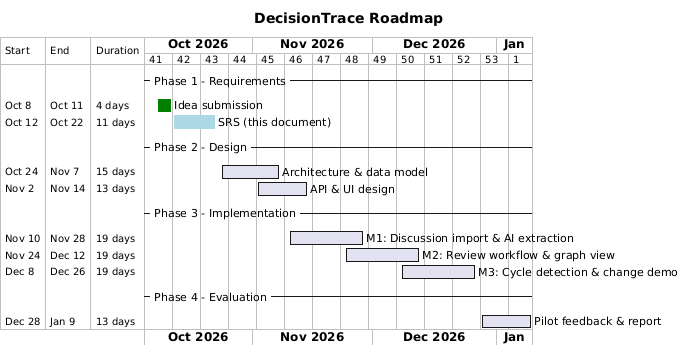

### Milestones

| Milestone | Date | Deliverable | Exit criterion |
|---|---|---|---|
| M0 | 2026-10-12 | Idea submission | Submitted to Canvas; written feedback received |
| M1 | 2026-10-23 | SRS (this document) | All 11 sections complete; submitted with modelling files |
| M2 | ~2026-11-15 | Design (Part II) | Architecture, data model, API and UI designed and reviewed |
| M3 | ~2026-12-01 | MVP v1 — manual records | Discussion input, decisions, commitments, dependencies, status updates, impact detection, audit trail (mostly implemented already) |
| M4 | ~2026-12-15 | MVP v2 — AI-assisted | LLM extraction of candidates + Confirm/Edit/Reject review workflow |
| M5 | ~2026-12-27 | MVP v3 — graph view | Topological order display, cycle detection, change/conflict scenario demo |
| M6 | ~2027-01-10 | Evaluation | Pilot feedback collected; accuracy, usability and cost reported |

Each implementation milestone is demoable on its own, so a late-phase slip costs one feature, not the whole project.

---

## 5. Use Case and Business Process Modelling

### 5.1 Actors

| Actor | Description |
|---|---|
| **Team Member** | Contributes and reviews project records: imports discussions, reviews AI candidates, confirms own commitments, updates status, browses history. |
| **Team Lead / Project Manager** | Creates and revises decisions, assigns commitments, inspects dependencies and blockers, reviews conflict and change impact. |
| **AI Assistant** | System-internal actor: extracts candidate decisions/commitments/dependencies from discussions and flags potential conflicts. It never writes authoritative records — its output is always routed through human review (UC03). |
| **New Team Member** | Read-only consumer: searches historical decisions and rationale for onboarding. |

### 5.2 Use Case Diagram

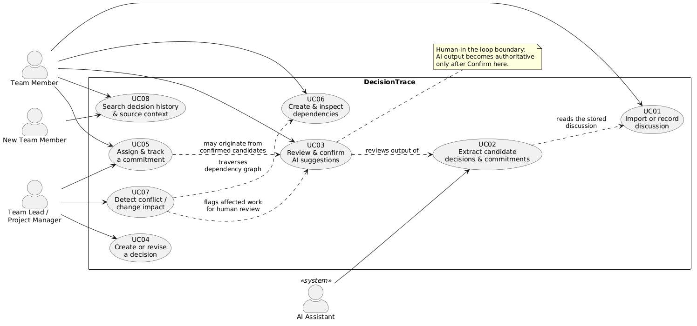

### 5.3 Use Case Summaries (2–4 lines each)

| ID | Use Case | Summary |
|---|---|---|
| UC01 | Import or record discussion | A team member pastes a meeting transcript or chat excerpt (or writes a short note) into the system. The system stores it as a Discussion record linked to the project, ready for AI extraction. |
| UC02 | Extract candidate decisions and commitments | The AI Assistant analyzes a stored discussion and produces **candidate** Decisions, Rationale, Commitments and Dependencies. All output is marked as unconfirmed candidates awaiting human review. |
| UC03 | Review and confirm AI suggestions | A team member reviews each candidate and chooses **Confirm, Edit or Reject**. Confirmed records become authoritative project facts and keep their source discussion and confirming user. |
| UC04 | Create or revise a decision record | A team lead creates a decision manually, or revises an existing one (e.g. superseding it). Revising a decision triggers a review of the commitments and dependencies linked to it. |
| UC05 | Assign and track a commitment | A team lead assigns a commitment with an owner and due date; members update its status (OPEN → IN_PROGRESS → …) with an optional reason. Every status change is appended to the audit trail. |
| UC06 | Create and inspect dependencies | A team member links two commitments with a relationship such as BLOCKS. The system rejects invalid links (e.g. a commitment depending on itself) and, after each new link, checks the graph for circular dependencies so a cycle never silently corrupts the plan. The dependency graph is displayed so teams can see what work relies on what. |
| UC07 | Detect possible conflict or change impact | When a commitment becomes DELAYED/BLOCKED (or a decision is revised), the system walks the BLOCKS edges transitively to identify all downstream commitments that may be affected, and flags circular dependencies, presenting both for human review. |
| UC08 | Search decision history and source context | Any user searches past decisions, their rationale, current owners and status evolution, following each record back to its source discussion — primarily for onboarding and later re-analysis. |

### 5.4 Detailed Use Case Specifications

The five use cases below form the core value chain: discussion in → records out → graph maintained → impact found. (UC04, UC06 and UC08 have the concise descriptions in 5.3.)

#### UC01 — Import or record discussion

| | |
|---|---|
| **Actors** | Team Member |
| **Preconditions** | The member belongs to the project |
| **Main flow** | 1. Member opens the project and clicks "New discussion". 2. Pastes a meeting transcript or chat excerpt, or types a short note; gives it a title. 3. System stores the Discussion linked to the project and shows it immediately. 4. System asks whether to run AI extraction on this discussion (opt-in, default off). |
| **Alternative flows** | 1a. Content empty → system rejects with a validation message. 4a. Member declines extraction → discussion is saved, no candidates are created; manual entry (UC04/UC05) remains available. |
| **Postconditions** | Discussion is stored; if opted in, extraction is queued (UC02). |

#### UC02 — Extract candidate decisions and commitments (AI)

| | |
|---|---|
| **Actors** | AI Assistant (primary); triggered by a Team Member in UC01 |
| **Preconditions** | A discussion with content exists; the member opted in; the LLM provider is configured |
| **Main flow** | 1. System sends minimized content (names, dates, task descriptions — see 7.6) to the LLM with a structured extraction prompt. 2. LLM returns candidate Decisions (title, rationale), Commitments (owner, description, due date) and Dependencies (predecessor → successor). 3. System stores each candidate with status PENDING, linked to the source span it came from. 4. System notifies the member that candidates are ready for review (UC03). |
| **Alternative flows** | 2a. Extraction fails or times out → discussion stays usable; manual entry offered; one retry. 2b. LLM returns malformed output → discarded after one retry, member notified. 2c. Nothing worth extracting found → member notified. |
| **Postconditions** | Candidates stored; **no authoritative record created** — AI output stops here. |

#### UC03 — Review and confirm AI suggestions

| | |
|---|---|
| **Actors** | Team Member (or Team Lead) |
| **Preconditions** | At least one PENDING candidate exists |
| **Main flow** | 1. User opens the review list; every candidate shows its type, proposed fields, and the exact source text it was extracted from. 2. For each candidate the user chooses Confirm, Edit or Reject. 3. Confirm → system creates the authoritative record (Decision / Commitment / Dependency), stamped with the source discussion and the confirming user. 4. Edit → fields are pre-filled for correction, then the user confirms. 5. Reject → candidate is marked REJECTED with an optional reason, kept for audit. |
| **Alternative flows** | 3a. Confirming a candidate that misses a required field (e.g. a commitment without owner) → validation error, user must edit first. 3b. A similar confirmed record already exists → system shows the match and asks the user to skip or merge. 3c. Batch review: user may reject all low-confidence candidates at once. |
| **Postconditions** | Authoritative records exist only via this use case; every confirm/edit/reject decision is recorded. This is the human handoff point of the system. |

#### UC05 — Assign and track a commitment

| | |
|---|---|
| **Actors** | Team Lead (creates/assigns), Team Member (updates own status) |
| **Preconditions** | Project exists; a Decision may optionally exist to link the commitment to |
| **Main flow** | 1. Lead creates a commitment: owner, description, due date, optional link to a Decision. 2. System stores it with status OPEN. 3. Owner opens the dashboard, picks a new status and optionally types a reason. 4. System validates the status (allowed set, different from current), writes an audit entry (old → new, reason, timestamp), then applies the change. 5. If the new status is DELAYED or BLOCKED, the system runs the impact check (UC07). |
| **Alternative flows** | 4a. Status outside the allowed set → rejected with an error message. 4b. Same status as current → rejected. 4c. Risky status (DELAYED/BLOCKED) without a reason → allowed, but the UI prompts for a reason because it helps everyone downstream. |
| **Postconditions** | Commitment updated; audit trail appended — history is never overwritten. |

#### UC07 — Detect possible conflict or change impact

| | |
|---|---|
| **Actors** | Team Lead (primary); system runs the check automatically; affected members are informed |
| **Preconditions** | The dependency graph exists; a commitment changed to DELAYED/BLOCKED (UC05) or a decision was revised (UC04) |
| **Main flow** | 1. Trigger: a risky status change or a decision revision. 2. System computes the transitive closure of BLOCKS edges starting from the changed commitment. 3. System checks the dependency subgraph for circular dependencies. 4. Result is shown: the list of affected commitments (owner, description, dependency path) plus any cycle warnings. 5. The lead reviews and decides per affected item: reassign, reschedule, or dismiss with a note. |
| **Alternative flows** | 2a. No downstream commitments → report shows "no impact detected". 3a. Cycle found → prominent warning; the edge that would create the cycle is rejected at creation time (UC06), so this path only triggers for legacy data. 4a. Decision revision → instead of graph traversal, all commitments linked to the revised decision are flagged for review. |
| **Postconditions** | Impact report displayed; **no record is changed automatically** — the lead's decision is recorded as a follow-up change.

### 5.5 Activity / BPMN Diagrams

**Process 1 — From discussion to confirmed record (UC01 → UC02 → UC03).**
The yellow nodes are AI steps, the red nodes are the human review boundary, and the green node is where a record finally enters the graph.

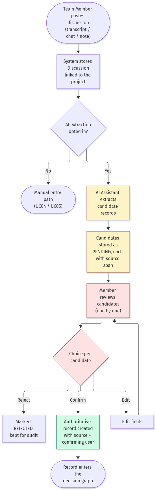

**Process 2 — Status update and downstream impact (UC05 → UC07).**
The audit entry is written before anything else changes, and the impact check runs only for risky states.

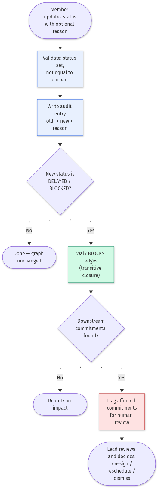

**Process 3 — Decision revision and conflict review (UC04 → UC07).**
A revised decision does not silently invalidate its commitments; every linked commitment is flagged and the team decides per item.

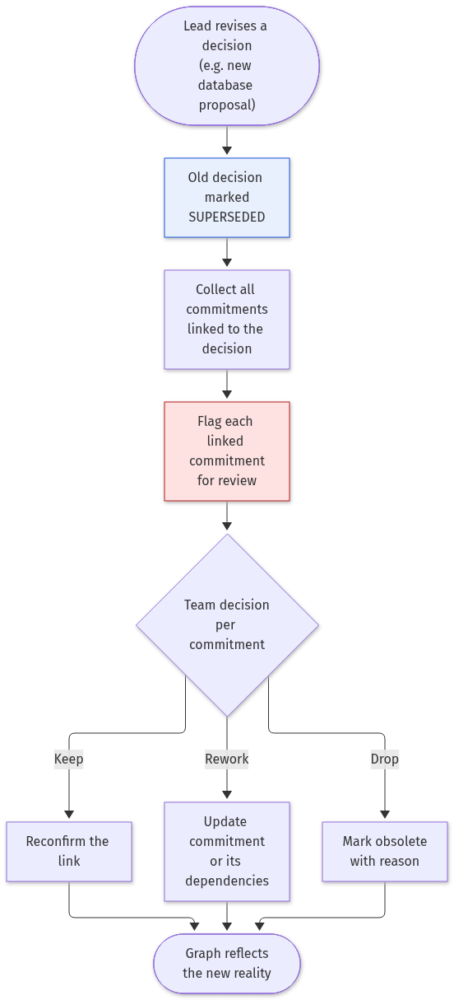

### 5.6 What the AI component can act on (inputs, actions, handoff)

The assignment asks us to show, for an AI-assisted component, what it can act on and where it hands off to a human.

| | Content |
|---|---|
| **Inputs** | The text of one discussion (minimized: names, dates, task descriptions); the existing decision graph, used to hint at duplicate or conflicting records |
| **Actions (proposals only)** | Propose candidate Decisions, Commitments and Dependencies; rank candidates by confidence; draft rationale summaries; flag possible conflicts with existing records |
| **Handoff point 1 — mandatory** | Candidate review (UC03): every AI proposal stops at the Confirm / Edit / Reject screen. Nothing enters the graph without a human. |
| **Handoff point 2 — mandatory** | Impact and conflict reports (UC07): the AI (later the graph algorithms) presents affected work, and a human decides reassign / reschedule / dismiss. The system never changes records by itself. |
| **What the AI never does** | Confirm a decision, assign an owner, rewrite history, or present uncertain inference as fact |

---

## 6. Glossary

| Term | Definition |
|---|---|
| **Discussion** | Raw source material — a meeting transcript, chat excerpt or manually written note — from which structured project records are derived. |
| **Decision** | A formal, authoritative record of what the team decided. Stores title, rationale, status (e.g. CONFIRMED), owner, and a reference to its source discussion. |
| **Rationale** | The reasoning or justification recorded behind a decision (e.g. "payment transactions require transaction support"). |
| **Commitment** | A formal record of who explicitly agreed to do what and by when. Stores owner, description, due date and status. |
| **Dependency** | A directed relationship between two commitments, e.g. **BLOCKS**: the predecessor commitment must complete before the successor can proceed. |
| **Predecessor / Successor** | In a dependency, the upstream (blocking) commitment and the downstream (blocked) commitment respectively. |
| **Candidate** | An AI-extracted record that has not yet been reviewed by a human. Candidates have no authority and are invisible to impact analysis until confirmed. |
| **Confirmation** | The human act (Confirm / Edit / Reject) that promotes a candidate into an authoritative project record, storing the confirming user and source. |
| **Human-in-the-loop** | The system's core design principle: AI suggests and structures information, humans authorize formal decisions and responsibility assignments. |
| **Impact Analysis** | The automatic detection of downstream commitments that may be affected when an upstream commitment enters a risky state (DELAYED / BLOCKED) or a decision changes. |
| **Audit Trail** | The append-only history of status changes (old status → new status, reason, timestamp) that preserves how commitments evolve over time. |
| **Status** | The lifecycle state of a commitment. Currently: OPEN, IN_PROGRESS, DELAYED, BLOCKED, COMPLETED. |
| **Traceability Chain** | The end-to-end record chain Discussion → Decision (with Rationale) → Commitment → Dependency → Change that the system preserves. |
| **Change** | A later modification of an authoritative record — e.g. a decision superseded by a new proposal — which triggers review of dependent commitments (planned). |
| **Decision Graph** | The directed graph formed by all project records: Discussions, Decisions, Commitments and Changes as nodes, connected by derivation, BLOCKS and supersession edges. This graph is the system's core data view. |
| **Topological Order** | An ordering of commitments consistent with the BLOCKS edges, so every commitment appears after everything it depends on. The system uses it to show which work can start now and which is held up by upstream work. |
| **Cycle (Circular Dependency)** | A dependency path that returns to its starting commitment (e.g. A BLOCKS B and B BLOCKS A). A cycle means no valid topological order exists; the system flags it as a warning instead of presenting an unexecutable plan. |
| **Graph Snapshot** | A meeting summary rendered as a subgraph: the new discussions, decisions, commitments and edges produced by one meeting, shown connected to the existing records they build on. |

*(18 terms — exceeds the required minimum of 10.)*

---

## 7. Supplementary Specification (Non-Functional Requirements)

### 7.1 Usability

Explicit, measurable usability goals for the target users in Section 2.5:

| ID | Goal | Measure |
|---|---|---|
| U1 | Learnability: a new member can orient themselves without training | Trace one decision back to its source and forward to affected work within 10 minutes of first login |
| U2 | Efficiency — trace: "why" questions are fast | Reconstruct the rationale and current downstream state of any decision in under 2 minutes, ≤ 3 interactions from the dashboard |
| U3 | Efficiency — review: AI help saves time, not adds work | Reviewing a batch of 10 AI candidates takes less time than entering the same 10 records by hand (target: ≥ 50% time saving, measured in the pilot, M6) |
| U4 | Efficiency — status: frictionless updates | Update a commitment status including an optional reason in ≤ 30 seconds |
| U5 | Transparency: no blind confirmation | Every AI candidate displays the exact source text it was extracted from; a user can confirm without this display being absent — it is always shown |
| U6 | Satisfaction: the workflow feels trustworthy | Average ≥ 3/5 in the pilot survey (M6) on "I trust the review workflow to keep project facts correct" |

### 7.2 Security

- Only project members can read or change a project's records. Roles: viewer (read), member (edit), lead (manage decisions and dependencies). The MVP uses one authentication scheme with per-project roles (planned — not yet in the current prototype).
- Record changes are append-only where they matter: status changes always write an audit-trail entry with old value, new value, reason and timestamp. There is no silent rewriting of history.
- All input is validated at the API layer and stored through SQLAlchemy parameterized queries (no string-built SQL), preventing injection.
- The AI provider never receives credentials, personal contact data or content unrelated to the discussion being processed (data minimization, Section 7.6).

### 7.3 Maintainability

- Layered architecture (routes / schemas / models / database) with the domain rules (status validation, impact detection, dependency validation) centralized in one place per rule, not duplicated in the UI.
- SQLAlchemy isolates the database; migration from SQLite to PostgreSQL is a configuration change with no model rewrite (documented in the repository README).
- PR-based workflow with review required before merging; ESLint for the frontend; automated tests for status rules and dependency/impact logic (planned).
- Every model decision (status set, dependency semantics, graph algorithms) is described in this SRS and the repository docs so a new maintainer does not need to reverse-engineer intent.

### 7.4 Performance

- The dashboard loads in under 2 seconds on a local network for a project with up to 500 records (the MVP target scale).
- Impact analysis runs as a graph traversal linear in the number of edges; for the MVP scale it is instant and recomputed on every dashboard load (current prototype behavior).
- AI extraction is asynchronous: the discussion is saved and visible immediately, candidates appear when ready (target ≤ 30 s for a 15-minute transcript on a free-tier API).

### 7.5 Reliability

- A status update either succeeds together with its audit entry or fails leaving nothing written (single database transaction).
- Once cycle detection is in place, the system refuses to store a dependency that would create a circular plan.
- Data survives restarts (SQLite file on disk); a backup/copy instruction is documented; corrupt-database recovery is "restore the file" at MVP scale.

### 7.6 AI-specific requirements

- **Accuracy / reliability.** The human gate changes what accuracy matters. A candidate that misreads an owner or date is caught at review, so the acceptable first-pass error rate for extraction is generous: ≥ 80% of owner/date/dependency fields correct in the pilot test. The metric that must stay at (near) zero is errors in *confirmed* records — those are checked through the audit trail and the confirm-edit log. How we check: a marked pilot set of 20 discussions, field-level precision measured before review.
- **Latency and cost.** Extraction latency target is in 7.4. Cost per 15-minute transcript extraction must stay inside a free-tier LLM budget; actual measured costs are reported in Section 11.
- **Autonomy.** The AI may propose candidate nodes and edges, rank candidates by confidence, and draft rationale summaries. It may not confirm a decision, assign an owner, rewrite history, or treat uncertain inference as fact. Every unsupervised output is read-only until a human confirms it (the Confirm/Edit/Reject boundary in UC03).
- **Privacy.** Sending a discussion to the LLM provider is opt-in per discussion; only minimized content (names, dates, task descriptions) is sent; raw transcripts are not retained by the provider where configuration allows; and a fully manual entry path exists for discussions the team does not want to send anywhere.

---

## 8. UI Mockups

Five screens: one is a screenshot of the running prototype, four are design mockups (HTML sources included in the submission under `mockups/`, so the team can reuse them as the frontend skeleton).

### Screen 1 — Project dashboard (implemented, real screenshot)

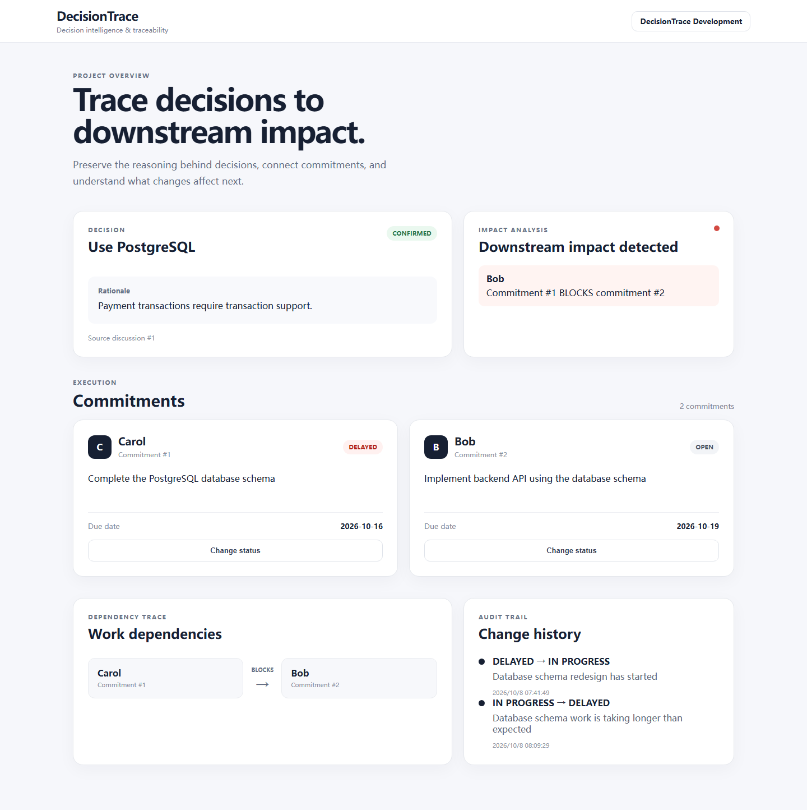

The current working prototype. It shows the decision with its rationale and source discussion, the impact analysis card (red state = downstream impact detected), all commitments with inline status editing (status + reason → audit trail), the dependency trace (Carol → BLOCKS → Bob) and the change history timeline.

### Screen 2 — Discussion import

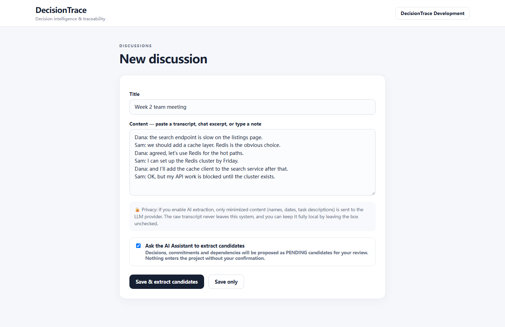

Where the chain starts. The user pastes a transcript or types a note. AI extraction is an explicit opt-in checkbox; the privacy note explains that only minimized content (names, dates, tasks) is sent to the LLM provider, and "Save only" keeps everything local. This implements the privacy requirement in 7.6.

### Screen 3 — Candidate review (the AI handoff point)

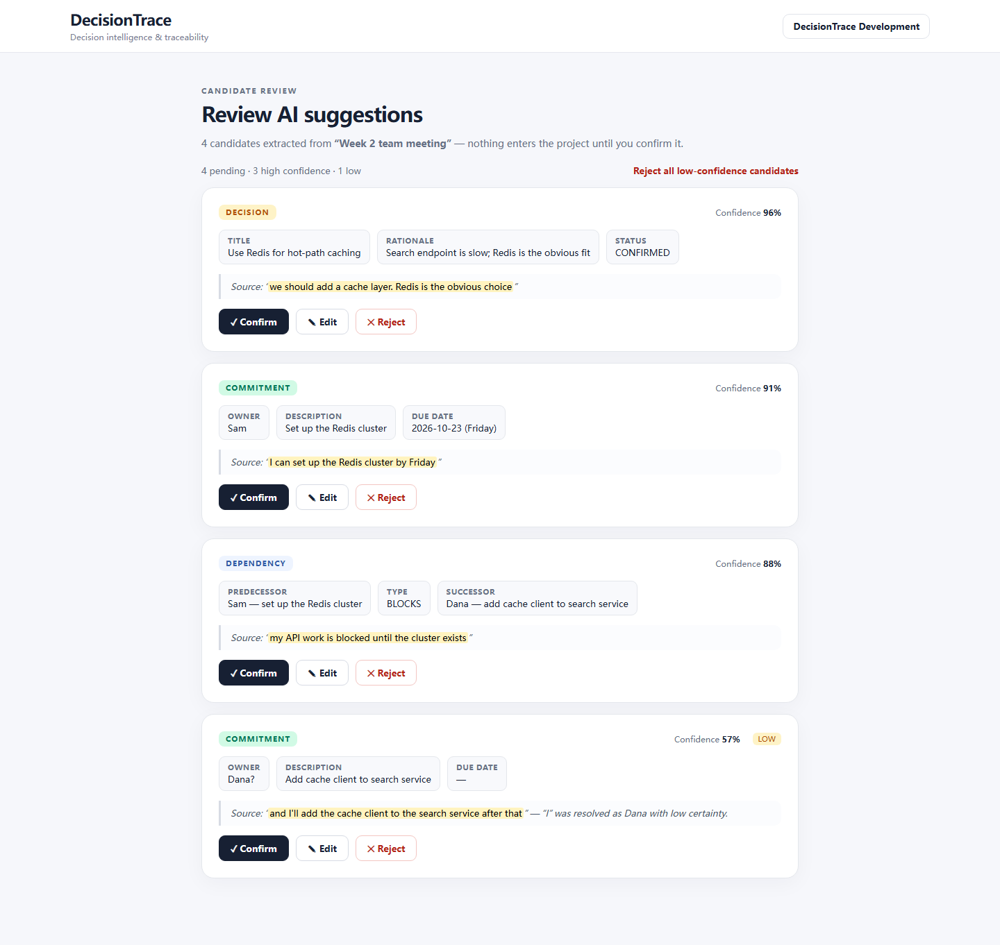

The review list from UC03. Each candidate shows its type, extracted fields, a confidence score, and — always — the exact source text with the matched span highlighted (usability goal U5). Buttons are Confirm / Edit / Reject per item, plus a batch action to reject all low-confidence candidates at once (anti-fatigue, risk O2).

### Screen 4 — Decision detail & revise

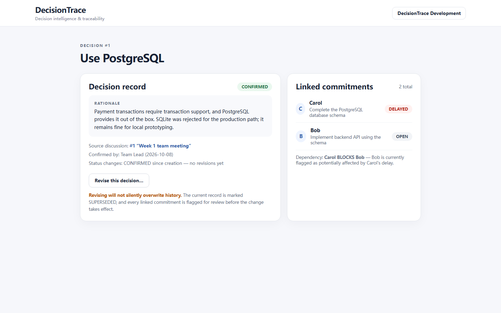

The decision record with rationale, source discussion link, who confirmed it, and the commitments linked to it. The "Revise this decision" action carries an explicit warning: the old record is marked SUPERSEDED, nothing is silently overwritten, and linked commitments are flagged for review — the revision flow of UC04/UC07.

### Screen 5 — Decision graph view (the innovation, planned)

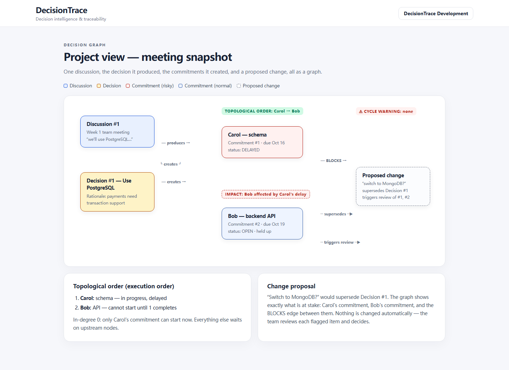

The graph-structured meeting snapshot. One discussion, the decision it produced, the commitments it created and a proposed change, rendered as a graph. The top strip shows the computed facts: the topological order (Carol → Bob), a cycle warning slot, and the impact flag on Bob. The side panels explain what the graph answers: who can start now, and what a proposed change puts at stake.

---

## 9. References

Each reference is annotated with how it shaped this project.

[1] C. Larman, *Applying UML and Patterns: An Introduction to Object-Oriented Analysis and Design and Iterative Development*, 3rd ed. Upper Saddle River, NJ: Prentice Hall, 2004. ISBN 978-0131489066.

> Our main method reference for this course. It shaped how we structure use cases (concise descriptions plus a few detailed specifications), the iterative, MVP-first plan in Section 4, and our preference for models that communicate clearly over strict UML ceremony.

[2] O. Gotel and A. Finkelstein, "An Analysis of the Requirements Traceability Problem," in *Proc. 1st Int. Conf. on Requirements Engineering (ICRE)*, IEEE, 1994, pp. 94–101. DOI: 10.1109/ICRE.1994.292398.

> Distinguishes pre- and post-specification traceability and argues that most traceability failures come from losing the origins of requirements. It is why every DecisionTrace record links back to its source discussion, not just forward to tasks — the "pre-" half of our trace chain.

[3] M. Nygard, "Documenting Architecture Decisions," blog post, Nov. 15, 2011. https://cognitect.com/blog/2011/11/15/documenting-architecture-decisions

> The original Architecture Decision Record article: decisions are written down with rationale and consequences, and superseded rather than deleted. Our Decision and Change records follow this idea, extended from architecture to general project decisions and connected to commitments.

[4] S. Amershi, D. Weld, M. Vorvoreanu, et al., "Guidelines for Human-AI Interaction," in *Proc. CHI 2019*, ACM, 2019. DOI: 10.1145/3290605.3300233.

> Eighteen guidelines for AI-infused interfaces. We used G1/G2 (be clear about what the AI can and cannot do well), G9 (support efficient correction — our Edit button) and G11 (make clear why the AI proposed something) as the design basis for the candidate review screen, UC03.

[5] G. Tur, A. Stolcke, L. Voss, et al., "The CALO Meeting Assistant System," *IEEE Trans. Audio, Speech, and Language Processing*, vol. 18, no. 6, pp. 1601–1611, 2010. DOI: 10.1109/TASL.2009.2038810.

> Describes a meeting assistant that transcribes meetings and extracts action items and decisions. It shows the extraction half is already solved well, and confirms our gap: such systems summarize a meeting but do not keep its decisions and dependencies linked to the project afterwards.

---

## 10. Team Member Contributions

| Member | Student ID | Roles | Contributions |
|---|---|---|---|
| 王耀增 | 2451393 | Team lead — coordination and task assignment; frontend–backend API; review and optimization | Coordination and task assignment; frontend–backend API design and integration; code review and optimization; SRS structure, roadmap and documentation review. |
| 农国达 | 2453193 | Testing, problem discovery and feedback | Tested the end-to-end PostgreSQL/Carol/Bob scenario against the use cases; verified status flows and audit-trail correctness; reported defects and usability issues, recorded in the backlog. |
| 李灏文 | 2453192 | Frontend design | React dashboard UI: decision card, commitment list with inline status editing, dependency trace and change-history timeline; designed the four SRS mockups (discussion import, candidate review, decision detail, graph view). |
| 陈昊宗 | 2453197 | Backend logic | FastAPI backend: models, routes and schemas for Project, Discussion, Decision, Commitment and Dependency; status-update validation; transitive impact detection over BLOCKS edges; append-only audit trail. |

---

## 11. AI Tools Reflection

> **[DRAFT — based on idea submission §10, to be updated with real usage]**

### Tool chain

| Tool | Task |
|---|---|
| ChatGPT | Brainstorming ideas, competitor comparison, refining requirement wording, reviewing document structure |
| DeepSeek | Drafting and cross-checking SRS content in Chinese; LLM backend for Claude Code development sessions |
| Claude Code (Anthropic) | Implementation and documentation: FastAPI backend, React dashboard, SRS drafting, diagram sources, UI mockups |
| Playwright (scripted via Claude Code) | Capturing the dashboard screenshot and rendering the HTML mockups to PNG |
| kroki.io | Rendering PlantUML and Mermaid diagram sources to SVG/PNG |
| GitHub | Version control and PR-based collaboration (main branch protected) |
| *(TBD)* LLM API | Planned for the in-product extraction feature (not yet integrated) |

### Cost

| Item | Amount / Detail |
|---|---|
| ChatGPT subscription | Plus — $20/month (monthly plan) |
| DeepSeek API | ≈12,000,000 tokens consumed (deepseek-v4-pro); ≈¥30–45 at list prices (¥3/M input, ¥6/M output) |
| Claude Code | Free CLI; model usage billed through the DeepSeek API above |
| Other paid services | None (kroki.io, Playwright, GitHub — free) |
| Free-tier limits reached? | No |
| Human hours per member on AI-assisted tasks | ≈5 h/day per member on average (over the Part I period) |
| Human hours per member verifying AI output | Included in the above — verification is part of the daily AI-assisted workflow |

### Pros / Cons

Strengths, from actual use:

- Drafting a full SRS section (SWOT, risk register, use case specs) takes minutes instead of an evening, which let us spend our time on the decisions that mattered — e.g. arguing about the graph model.
- Diagram sources (PlantUML/Mermaid) are text, so diagrams are reviewable in pull requests like code, and regenerating a diagram after a wording change costs one API call.
- The mockup workflow (HTML → Playwright screenshot) gave us pixel-accurate screens without a designer.

Limitations, from actual use:

- AI drafts come out with a recognizable "AI voice" — generic phrasing and hedged claims. The instructor's feedback caught exactly this, and we rewrote those sections by hand (§2.7).
- The AI does not know our project's history; it proposed plausible-sounding features that were already outside the MVP boundary and had to be cut (e.g. calendar integration).
- Every generated artifact still needed verification: bibliographic details of references were checked one by one against publisher pages before they went into Section 9.

### Verification

- Team discussion and code review of every AI-generated change
- PR-based workflow: changes require approval before merging into main
- Consistency checks between requirements, design and implementation
- References in Section 9 were verified against the original sources (publisher pages, DOI records) — no AI-supplied citation was accepted unchecked
- AI-extracted project records will be human-reviewed by design (the Confirm/Edit/Reject boundary)

### Enhancement

- The biggest enhancement came from the instructor feedback, not from AI: the graph-structured meeting summary with topological ordering (§2.3) was the team's response to the feedback, and the AI's job was to work it into the models, use cases and glossary consistently.
- All SRS sections drafted by AI were rewritten by team members to remove AI-flavored phrasing and to add concrete, honest statements (e.g. admitting the extraction component is not yet implemented).
- AI-proposed features outside the MVP boundary (calendars, chat integrations) were explicitly rejected and recorded as out of scope.

### Artifacts

- Representative prompts: `docs/SRS/ai-artifacts/prompts.md`
- Diagram sources (reviewable, regenerable): `docs/SRS/diagrams/*.puml`, `*.mmd`
- Mockup sources: `docs/SRS/mockups/*.html` (+ screenshot script)
- Git history of the implementation (PR-based workflow)

---
