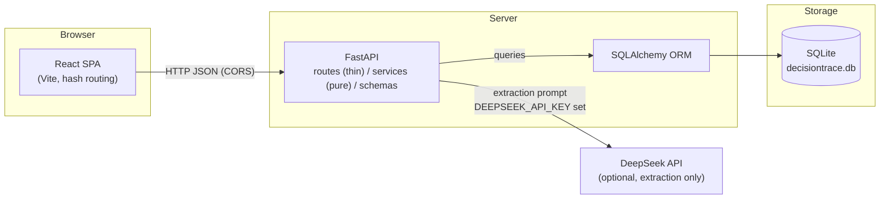
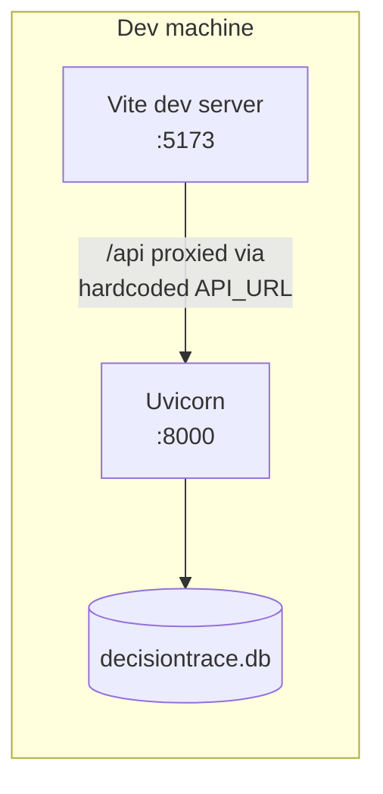

# Architecture Design

Part II design document — DecisionTrace

**Status:** Draft for team review (2026-11-04)
**Milestone:** M2 (~2026-11-15)

## 1. System Overview

DecisionTrace is a single-page web application backed by a REST API and a
local SQLite database. The architecture deliberately stays three flat
layers: the product's depth is in the relationships between records, not
in a deep service hierarchy.

## 2. Layer Responsibilities

| Layer | Location | Responsibility |
|---|---|---|
| Views | `frontend/src/` | One React app, eight views. Components in `components/`, view registry in `views.js`. |
| Routes | `backend/app/routes/` | One router per entity + `search.py`. HTTP concerns only: validation, 404s, response models. |
| Services | `backend/app/services/` | Pure functions: extraction, graph analysis (topological sort, cycles, transitive impact), consistency checks, pagination helpers, search scoring. No HTTP objects. |
| Schemas | `backend/app/schemas/` | Pydantic request/response models; the pagination envelope `Page[T]` is shared by every list endpoint. |
| Models | `backend/app/models/` | SQLAlchemy tables. Imported by `main.py` so `create_all` registers every table. |
| Data | `backend/decisiontrace.db` | SQLite. One file, gitignored; the committed demo state matches the README scenario. |

## 3. Key Architectural Decisions

| # | Decision | Rationale |
|---|---|---|
| A1 | SQLite instead of a server database | Zero setup for demo and teammates; the schema is plain SQLAlchemy so a later migration to PostgreSQL changes only the connection string. |
| A2 | AI output is always a *candidate* | Extraction can never create authoritative records; a human confirms, edits, or rejects. Trust boundary is explicit in the data model (`candidates.status`). |
| A3 | Rule-based extraction by default, DeepSeek LLM when `DEEPSEEK_API_KEY` is set, falling back to rules on any failure | The demo always works offline; the LLM path is an upgrade, not a dependency. |
| A4 | Offset pagination with a shared envelope (`items/total/limit/offset/has_more`) | One client contract (`usePagedList`) for every list; keeps lists small and the UI's page count truthful. Cursor paging adds complexity with no benefit at this scale. |
| A5 | Records are immutable; changes are appended to history tables | `decision_history`/`commitment_history` store old→new pairs with a reason. Delete endpoints cascade the dependent rows; nothing silently overwrites the trace. |
| A6 | Hash-based view routing (`#decisions`, `#audit`, …) | The sidebar, URL, and back button stay in agreement; cross-section links (conflict chip → audit) are plain anchors. |
| A7 | Single frontend, project context in state + `localStorage` | Multi-project support exists at the API level; the UI remembers the last active project and swaps the whole dashboard on switch. |
| A8 | Consistency and graph questions computed on read, not stored | Cycle detection, topological order, and impact (transitive closure over `BLOCKS` edges) derive from the current graph; no denormalized caches to drift out of sync. |

## 4. Deployment (development)

- Frontend: `cd frontend && npm run dev` (Vite, port 5173). Production build: `npm run build` → `frontend/dist/` (gitignored).
- Backend: `cd backend && .venv/Scripts/python -m uvicorn app.main:app --port 8000`.
- The frontend calls the backend at a hardcoded `http://127.0.0.1:8000`; CORS is open for local development. A reverse proxy in front of both would remove the hardcode if the app is ever hosted.

## 5. Security & Integrity Notes

- No authentication or roles: the MVP is a single shared workspace per project (the idea submission explicitly keeps depth in relationships, not user roles).
- SQLite file is local-only; deployment to a shared host would need auth plus a server database.
- Search snippets are server-escaped before a single `<mark>` is injected (see `services/search.py`), so query terms cannot inject markup.
