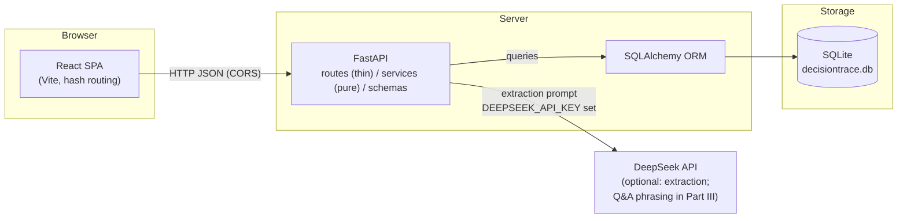
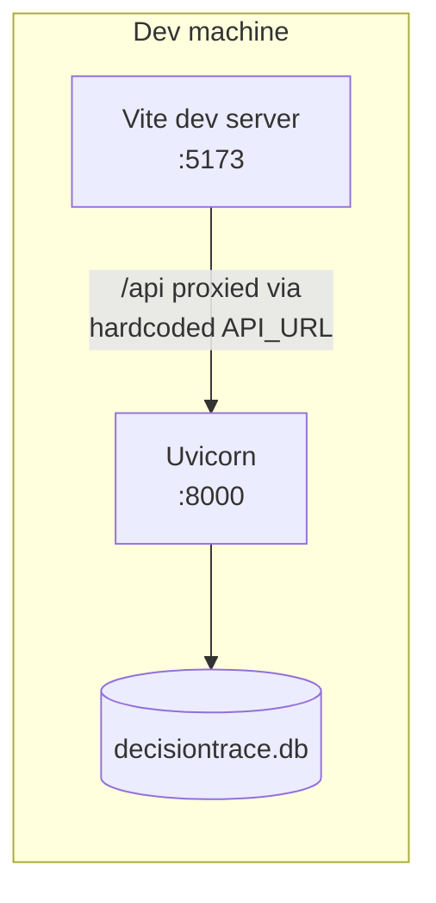

# Architecture Design

Part II design document — DecisionTrace

**Status:** Draft for team review (2026-11-04; updated 2026-11-09 after the
Week 9 presentation feedback; updated 2026-11-12 after the instructor's
follow-up critique that the product form was "lower-level than the idea"
and less usable than plain meeting minutes)
**Milestone:** M2 (~2026-11-15)

## 1. System Overview

DecisionTrace is a single-page web application backed by a REST API and a
local SQLite database. The architecture deliberately stays three flat
layers: the product's depth is in the relationships between records, not
in a deep service hierarchy. The relationships come in two layers: the
**execution layer** — dependencies between commitments (what is blocked,
what would be impacted) — and, new in this revision, the
**deliberation layer** — arguments for and against decisions (what is
contested, and why).

## 2. Stakeholders and Decision Goals

A decision is not a row in a table; it is a process with participants —
someone proposes, someone commits, someone depends on it, someone revises
it later. The presentation feedback asked who the decision makers are and
what each role wants to see; the instructor's follow-up critique made the
point sharper: decision-making is a high-level activity, so the design
must serve the *process*, not just store its conclusion. The table derives
the design from what each participant does at each moment of a decision's
life.

| Role | Their part in a decision | What they need at that moment | Design answer |
|---|---|---|---|
| Decision maker (project lead) | Proposes, approves, revisits | Which decisions are at risk? Where is the bottleneck? Who is overloaded? | Overview "needs attention" list, conflict detection, snapshot comparison, what-if preview |
| Commitment owner | Promises work under a decision | "What blocks me? If I slip, who do I hurt?" | Topological order, impact closure, overdue highlighting, due dates in the plan view |
| Dependent member | Waits on upstream work | "When will upstream finish? Did a decision change?" | Audit trail (old/new/reason per change), impact recomputed on read, snapshot diff |
| Dissenter / skeptic | Voices objections during deliberation | "My objection must not be silently dropped" | Arguments are first-class records; a decision with an open objection renders as contested everywhere |
| Discussion participant / note taker | Feeds the meeting into the system | "I should not have to re-type what we just discussed" | Intake accepts the raw discussion (paste/upload); extraction proposes records with source spans; review is confirm/edit/reject |
| Absent member / new joiner | Catches up after the fact | "What was decided and why?" without reading every transcript | Search over discussions, decisions and histories together; snapshots with diff; planned ask view with citations (Part III) |

**Decision goals are first-class data, not prose.** Every `Decision` row
stores its rationale and, when it came from a meeting, a pointer back to
the source discussion. That pair *is* the recorded decision goal: why we
decided, and where we said so. The impact closure over `BLOCKS` edges then
shows which downstream work the goal puts at risk, and the what-if preview
shows what a status change would do to it.

**A goal is a trajectory, not a value.** Decisions get proposed, argued
over, made, and later revised; the design treats that evolution as the
primary object. Revising a decision preserves how the goal evolved (old
and new rationale, with a reason). Snapshots capture the whole graph at
the end of a meeting, and snapshot comparison shows what changed since —
so "how did our goals move this week?" is a derived view, not a report
someone writes. This is the property plain meeting minutes cannot offer:
minutes record the words, the trace records the process.

**Consequences for the design** (why the features look the way they do):

- Rationale is displayed wherever a decision appears, and revising a
  decision writes the old and the new rationale to history, so the
  goal's evolution is never silently dropped. Manually created
  decisions require the rationale (API and form); extracted candidates
  are exempt because their goal context is the source discussion they
  point back to. See the requirements change log.
- The source link is first-class: search covers discussions, decisions and
  histories together, so "why did we decide this?" is one query.
- The impact panel and the what-if preview exist because owners and leads
  ask "what if?" questions — the graph views are answers to stakeholder
  questions, not features for their own sake.
- The intake path exists because the note taker is a stakeholder:
  feeding a meeting into the system must be cheaper than writing minutes
  by hand, or the tool loses to the minutes it replaces. §10 measures
  exactly that.

**The deliberation layer.** Arguments — the pros, cons and objections
behind each decision — are first-class records with their own computed
state (contested). The layer is specified in §6.

## 3. Layer Responsibilities

| Layer | Location | Responsibility |
|---|---|---|
| Views | `frontend/src/` | One React app, eight views. Components in `components/`, view registry in `views.js`. |
| Routes | `backend/app/routes/` | One router per entity + `search.py`. HTTP concerns only: validation, 404s, response models. |
| Services | `backend/app/services/` | Pure functions: extraction, graph analysis (topological sort, cycles, transitive impact), consistency checks, deliberation (contested computation), pagination helpers, search scoring. No HTTP objects. |
| Schemas | `backend/app/schemas/` | Pydantic request/response models; the pagination envelope `Page[T]` is shared by every list endpoint. |
| Models | `backend/app/models/` | SQLAlchemy tables. Imported by `main.py` so `create_all` registers every table. |
| Data | `backend/decisiontrace.db` | SQLite. One file, gitignored; the committed demo state matches the README scenario. |

## 4. Key Architectural Decisions

| # | Decision | Rationale |
|---|---|---|
| A1 | SQLite instead of a server database | Zero setup for demo and teammates; the schema is plain SQLAlchemy so a later migration to PostgreSQL changes only the connection string. |
| A2 | AI output is always a *candidate* | Extraction can never create authoritative records; a human confirms, edits, or rejects. Trust boundary is explicit in the data model (`candidates.status`). |
| A3 | Rule-based extraction by default, DeepSeek LLM when `DEEPSEEK_API_KEY` is set, falling back to rules on any failure | The demo always works offline; the LLM path is an upgrade, not a dependency. |
| A4 | Offset pagination with a shared envelope (`items/total/limit/offset/has_more`) | One client contract (`usePagedList`) for every list; keeps lists small and the UI's page count truthful. Cursor paging adds complexity with no benefit at this scale. |
| A5 | Records are immutable; changes are appended to history tables | `decision_history`/`commitment_history` store old→new pairs with a reason. Delete endpoints cascade the dependent rows; nothing silently overwrites the trace. |
| A6 | Hash-based view routing (`#decisions`, `#audit`, …) | The sidebar, URL, and back button stay in agreement; cross-section links (conflict chip → audit) are plain anchors. |
| A7 | Single frontend, project context in state + `localStorage` | Multi-project support exists at the API level; the UI remembers the last active project and swaps the whole dashboard on switch. |
| A8 | Consistency and graph questions computed on read, not stored | Cycle detection, topological order, and impact (transitive closure over `BLOCKS` edges) derive from the current graph; no denormalized caches to drift out of sync. |
| A9 | Automation-first intake; manual entry is a fallback | Uploading a discussion triggers extraction automatically and the review view is built for batch confirmation. The manual create forms cover missed extractions and decisions that never appear in a meeting — they are not the primary path. (Presentation feedback point 1.) |
| A10 | The discussion text is the system of record; the trace is a derived view | Every node and edge links back to the source sentence that produced it. Editing happens by confirming or correcting extraction — never by maintaining the graph by hand (A9). This is what keeps the tool no harder to use than the minutes it replaces. |
| A11 | Natural-language questions are answered from the derived graph, with citations (planned, Part III) | The ask view composes answers from authoritative records and shows the source spans behind each claim; the LLM, if used, only phrases answers — it never invents facts the trace does not contain. |
| A12 | Arguments are first-class; a decision carries its deliberation | Extracted pros, cons and objections become `Argument` records through the same candidate gate (A2), each pointing back to its source sentence. Recording the conclusion alone throws away the reasoning — the part that makes decision-making a high-level activity. |
| A13 | "Contested" is computed, never a manual status | A decision with ≥ 1 open `AGAINST` argument renders contested everywhere (badge, overview). Computed on read like cycles and impact (A8), so the state cannot drift from the arguments that justify it. |

## 5. Automation: Reducing Manual Effort

The instructor's follow-up critique: the idea is high-level, but the form
is the old one — manual entry — so the tool ends up less usable than the
meeting minutes it is meant to replace. That sets the bar for this whole
section: using DecisionTrace must cost no more effort than writing
minutes, while adding what minutes cannot do (queryable structure). Three
design rules follow, then what implements them.

**Rule 1 — The input is the discussion itself.** Minutes are not a
by-product the tool produces; they are the input. Pasting or uploading
the discussion is the entire data-entry step — there is no transcription
step on top of it.

**Rule 2 — The graph is derived, never hand-maintained.** Like an IDE's
symbol table is computed from the source code, the trace is computed from
the discussion text (A10). The source text stays the system of record:
every decision, commitment and dependency links back to the sentence it
came from. Derived views — topological order, impact, overdue, what-if,
snapshot diff — recompute themselves.

**Rule 3 — The human's only job is verifying.** Confirm / edit / reject,
plus fallback forms for what extraction misses. Everything below is one
of: making intake cheaper (Rule 1), making the system compute more
(Rule 2), or shrinking the review step (Rule 3).

**Implemented**

- Drag & drop / paste upload of discussions (`.txt/.md/.docx/.pdf`, UTF-8
  with GBK fallback) — Rule 1.
- Automatic extraction (rules, or DeepSeek when configured) producing
  candidates with the exact source text highlighted — Rule 2.
- Automatic **argument extraction** — pros, cons and objections become
  `ARGUMENT` candidates (stance + claim + author + target), with the
  same source-span highlighting; rule patterns cover English and Chinese
  cue phrases ("disagree" / "不同意" / "担心" / "风险") — Rule 2, the
  deliberation layer (§2).
- Paginated batch review: confirm / edit / reject per candidate without
  leaving the list — Rule 3.
- **Batch confirm** — select all on a page and confirm every candidate in
  one request (partial failures reported item by item).
- **Duplicate detection** — a pending candidate that repeats an existing
  decision, commitment or dependency carries a `duplicate_of` badge
  ("Decision #3") and is skipped by batch confirm by default; single
  confirm remains available for deliberate re-statements. Title matching
  tolerates the extractor's cleaning ("Use Redis" ≡ "Redis").
- **Rule-based meeting summary** — every discussion shows a summary
  preview (decisions / commitments / dependencies with names), computed
  offline from the rule engine, never via the LLM, so listing discussions
  cannot trigger API calls. One click saves the current graph as the
  meeting snapshot.
- Derived views recompute themselves: overdue highlighting, topological
  order, impact, what-if previews, **decision health metrics** (overturn
  rate, average lifespan of overturned decisions, revision rate,
  contested rate, objection resolution rate — the "reflect" step of the
  agent loop) — nobody updates these by hand.
- Meeting summary = graph snapshot: saving one captures the whole state.

**Planned (Part III PoC items, in priority order)**

1. **LLM summary upgrade** — when `DEEPSEEK_API_KEY` is set, a
   prose summary alongside the rule-based preview (same A3 fallback:
   rules when the LLM fails).
2. **Confidence-threshold batch confirm** — auto-select candidates above
   a confidence score instead of selecting by hand.
3. **Owner suggestion** — reuse the owner of past similar commitments to
   prefill the review form.
4. **Ask view (natural-language questions)** — "What is blocking the
   migration?" answered from the trace, with every claim linked to the
   source spans that support it (A11). Rules answer first; the LLM may
   phrase, never invent.
5. **Proactive alerts** — the overview tells the team what changed since
   the last visit without being asked: new conflicts, commitments that
   became overdue, decisions whose dependencies slipped. The system
   speaks first instead of waiting to be queried.
6. **Corrections as training signal** — confirmations, edits and rejects
   accumulate per discussion type and feed the rule engine, duplicate
   detection and owner suggestions, so the pipeline gets less wrong with
   use (the "learn" step of the agent loop).
7. **Argument map view** — a per-decision deliberation panel showing
   supporting and opposing arguments with their source spans, so a
   decision reads as a resolved debate instead of a verdict.
8. **Critical path & bottleneck analysis** — earliest/latest scheduling
   over the dependency graph with due dates, so the commitments actually
   on the critical path surface instead of every overdue one shouting at
   once.

The end-to-end bar is explicit and measured: turning a raw discussion
into the weekly graph snapshot must take less time than writing minutes
by hand — see the evaluation plan, §10.

## 6. The Deliberation Layer

The instructor's follow-up critique exposed what plain records throw
away: a decision is a *resolution of a deliberation* — alternatives,
pros, cons, objections — and recording only the conclusion records the
cheapest part. This revision adds the fifth concept, **Argument**, and
makes the deliberation a first-class layer of the product, evaluated
like every other part of the pipeline.

**What an argument is.** `FOR`/`AGAINST` stance, a claim, its author,
the decision it targets (nullable — a free-standing concern), and the
source sentence it came from. Arguments enter the trace through the same
candidate gate as every other record (A2): extraction proposes, a human
confirms, edits or rejects. Confirming an argument against a target that
does not exist fails with a fixable error, exactly like confirming a
dependency before its commitments.

**The graph becomes two layers.**

- *execution layer* — dependency edges between commitments: what is
  blocked, what would be impacted (topological order, cycles, impact);
- *reasoning layer* — argument edges onto decisions: what is supported,
  what is contested, and why.

**Contested is computed, never a manual status (A13).** A decision with
at least one open `AGAINST` argument renders as contested — badge on the
decision card, a marker in the decision selector, an attention entry in
the overview. Nobody sets it by hand, so it cannot drift from the
arguments that justify it (the same principle as A8).

**An objection is never silently dropped.** Arguments stay attached to
their decision until a human resolves them — and resolving requires a
reason, recorded on the argument. Free-standing arguments (no decision
yet) stay visible in the deliberation view instead of vanishing after
confirmation.

**Lifecycle.** discussion text → extraction proposes `ARGUMENT`
candidates (rules EN+ZH; DeepSeek when configured, same A3 fallback) →
human confirms → argument is `OPEN` → its decision shows contested while
any `AGAINST` is open → resolve (with reason) or delete.

**Where the layer is visible.**

| Surface | What it shows |
|---|---|
| Intake queue | `ARGUMENT` candidates with stance badge and source excerpt |
| Decision card | Deliberation panel: the decision's arguments, contested badge, resolve inline |
| Deliberation view | Every argument in the project, including free-standing ones; filters (all / open objections / resolved); resolve |
| Overview | "Needs attention" entry while any decision is contested |
| Search | Arguments are searchable like any other record (claim, author, stance, resolution reason) |

**Part III PoCs on this layer.** the argument-map view (a per-decision
deliberation panel), argument extraction quality targets (§10),
contested-state evaluation against a gold annotation, append-only
argument history, and corrections feeding back into the extractor (§5).

## 7. Deployment (development)

- Frontend: `cd frontend && npm run dev` (Vite, port 5173). Production build: `npm run build` → `frontend/dist/` (gitignored).
- Backend: `cd backend && .venv/Scripts/python -m uvicorn app.main:app --port 8000`.
- The frontend calls the backend at a hardcoded `http://127.0.0.1:8000`; CORS is open for local development. A reverse proxy in front of both would remove the hardcode if the app is ever hosted.

## 8. Security & Integrity Notes

- No authentication or roles: the MVP is a single shared workspace per project (the idea submission explicitly keeps depth in relationships, not user roles).
- SQLite file is local-only; deployment to a shared host would need auth plus a server database.
- Search snippets are server-escaped before a single `<mark>` is injected (see `services/search.py`), so query terms cannot inject markup.

## 9. Quality Attributes

From the SRS supplementary specification (§7); the architecture answers
each one.

| Attribute | Target | How the architecture meets it |
|---|---|---|
| Usability — learn | New member traces one decision to source and downstream in ≤ 10 min, untrained | One sidebar route per question (search, audit, impact); every record links to its source |
| Usability — trace | Any "why" answered in ≤ 2 min, ≤ 3 interactions | Search across records + histories; impact card one click from plan; hash links from every hit |
| Usability — review | Reviewing 10 candidates faster than typing them (≥ 50% saved, measured in the pilot) | Batch review UI; measured by the evaluation plan in §10 |
| Performance | Dashboard < 2 s at 500 records | Graph algorithms linear in edges; computed on read at MVP scale |
| Reliability | Status update + audit entry commit together or not at all; cycles never stored | Single transaction per update; cycle detection before edge creation |
| AI autonomy | AI proposes; only humans confirm/assign/rewrite | Candidate table as the only route from text to authoritative records (A2) |
| AI privacy | Sending a discussion to the LLM is opt-in per discussion | Manual entry path always available; minimized payload |

## 10. Evaluation Plan: Summarisation, Extraction, Verification

Meeting summarisation, key-information extraction and the human
verification step are the core of the system, so the technical approach
gets an explicit, measurable evaluation plan (presentation feedback point
2, sharpened by the instructor's follow-up critique that the evaluation
was not visible). The pipeline is evaluated in three parts — one protocol
each — plus one end-to-end experiment that tests the whole premise
against the "meeting minutes" baseline. All of it runs in Part III.

**Dataset.** 20 discussions from the team's own meetings, annotated at
field level (entity type, owner, date, dependency, source span) by two
team members independently; disagreements resolved by discussion.
Inter-annotator agreement is reported (simple agreement per field, and
Cohen's kappa on entity spans) so the gold set itself is trustworthy. The
set is frozen and reused for every iteration and every pipeline, so
results stay comparable.

**1. Summarisation quality** (rule-based vs. LLM summary). Measured
against the gold set: coverage (every gold decision, commitment and
dependency appears in the summary), faithfulness (nothing in the summary
lacks support in the discussion text), and snapshot correctness (saving
the summary as a graph snapshot yields the same nodes and edges a human
draws from the same discussion). Targets: 100% coverage of confirmed
entities, 0 invented entities, snapshot node/edge agreement ≥ 80%.

**2. Extraction quality.** Precision and recall per entity type
(decision / commitment / dependency), computed per field against the gold
set — accuracy alone would reward the extractor that stays silent, and a
missed decision is the worst failure because no human ever sees it.
Targets: precision ≥ 80% and recall ≥ 80% per type (the SRS §7.6
accuracy target, split honestly). Every failure is logged to an error
taxonomy — missed entity, wrong type, wrong field, wrong span,
hallucinated, wrong link — so each fix (prompt change, new rule,
stronger review step) is targeted at the dominant category.

**3. Verification cost.** A timed experiment: review 10 candidates versus
entering the same 10 records by hand. Target: ≥ 50% time saved (SRS
usability goal U3). Three more metrics characterise the gate itself:
confirmation rate (candidates confirmed unchanged), edit rate and reject
rate. They feed the confidence threshold for auto-confirm (Part III item
2) and show where review friction sits.

**4. Argument extraction and contested state.** Stance accuracy
(`FOR` vs `AGAINST`, target ≥ 80%), target-linking accuracy (argument
attached to the right decision, ≥ 80%), and contested-state precision
and recall against the gold annotation (a decision is annotated
contested iff the gold set contains an unresolved objection). Contested
precision matters most: a false contested badge erodes trust in the only
state the system computes by itself.

**End-to-end experiment: the minutes baseline.** The instructor's
critique is turned into a protocol: given the same raw 10-minute
discussion, one group writes minutes by hand and builds the week's graph
manually, the other uses DecisionTrace. Measured: total time, and graph
completeness (nodes/edges vs. the gold set). The tool wins only if it is
no slower than minutes-only while producing a full graph — this is the
pass condition for the product premise, not just for the extractor.

**Blind rules-vs-LLM comparison.** Both pipelines run on the same frozen
gold set; the person scoring does not know which pipeline produced each
output. Per-field counts are reported per pipeline, and the adoption rule
is fixed in advance (A3): the LLM path is kept only if it beats the rule
engine on at least one metric, loses on none of the targets, and stays
inside a per-discussion cost cap; otherwise we stay on rules.

**Errors in confirmed records.** Audit-trail spot checks on the pilot
project; the target is ≈ 0 errors in *confirmed* records, because those
are the ones with real consequences.

**Iteration loop and reporting.** Each iteration: run the protocols,
attribute failures via the taxonomy, apply one fix, re-run the same gold
set. Results are reported in Part III as one table per metric — pipeline ×
iteration — so the choice of technical approach is made by measurement,
not preference.

## 11. Open Issues & Risks (to test in Part III)

| # | Issue / risk | Part III validation |
|---|---|---|
| R1 | Status-transition matrix: only the vocabulary is enforced today; which jumps are legal (e.g. `DELAYED → COMPLETED`) has no formal rule | PoC an explicit transition rule set and measure how many real updates it blocks vs saves |
| R2 | Scale ceiling: SQLite single-machine + no authentication fits a team MVP only | Multi-tenant hosting would need auth, roles and a server database (A1 covers the migration path) |
| R3 | AI trust: field accuracy ≥ 80% is a target, not a measurement yet; whether review actually saves time vs manual entry is unmeasured | The evaluation plan in §10 is the protocol; results reported in Part III |
| R4 | Concurrent updates: append-only history prevents overwriting the trace, but two members updating the same commitment still race (last write wins) | Confirm mechanism or a version check on update |
| R5 | Dependency editing: edges can be created and removed but not edited (change type/endpoints) | Add PATCH for edges with the same cycle/duplicate checks |
| R6 | Argument history: resolving an argument updates the row in place (status + reason); there is no append-only `argument_history` yet, so A5 does not cover arguments | Part III: history table + resolution semantics; then resolutions join the audit trail |
| R7 | Deliberation state in snapshots: a graph snapshot captures commitments and dependencies, not the arguments of that meeting | Part III: include argument state in snapshots, or document explicitly why the execution layer alone is the snapshot unit |
| R8 | Argument-layer extraction quality: stance and target linking are rule heuristics today and unmeasured | A false contested badge erodes trust in the only state the system computes by itself | §10 protocol 4: stance accuracy ≥ 80%, target-linking accuracy ≥ 80%, contested precision/recall against the gold annotation |
