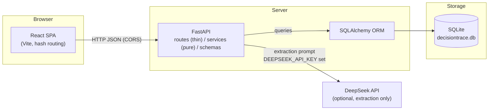
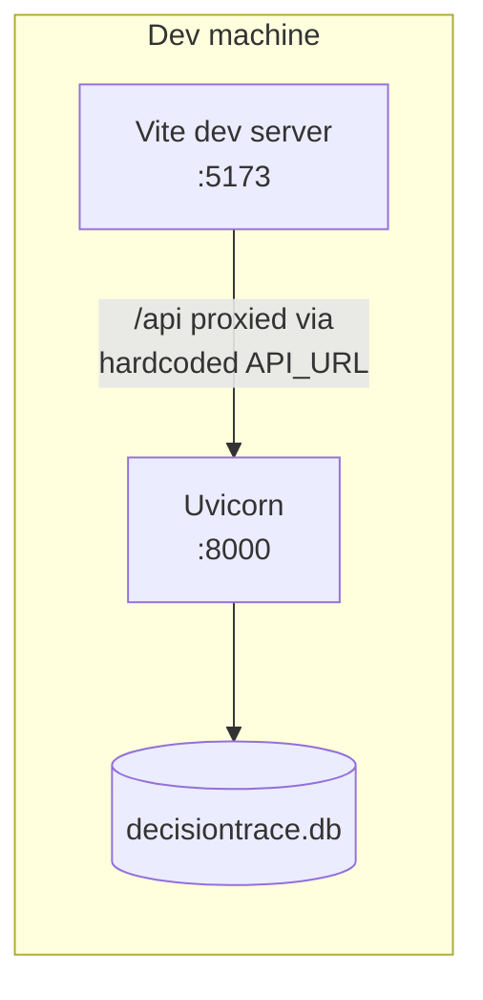

# Architecture Design

Part II design document — DecisionTrace

**Status:** Draft for team review (2026-11-04; updated 2026-11-09 after the
Week 9 presentation feedback)
**Milestone:** M2 (~2026-11-15)

## 1. System Overview

DecisionTrace is a single-page web application backed by a REST API and a
local SQLite database. The architecture deliberately stays three flat
layers: the product's depth is in the relationships between records, not
in a deep service hierarchy.

## 2. Stakeholders and Decision Goals

The presentation feedback asked who the decision makers are and what each
role wants to see. That analysis drives the design; the table states the
mapping explicitly.

| Role | Wants to know | Design answer |
|---|---|---|
| Commitment owner | "What blocks me? If I slip, who do I hurt?" | Topological order, what-if impact preview, overdue highlighting, due dates in the plan view |
| Project lead (decision maker) | "Which decisions are at risk? Where is the bottleneck?" | Overview "needs attention" list, consistency conflicts, graph snapshot comparison |
| Dependent member | "When will upstream finish? Did a decision change?" | Audit trail (old/new/reason per change), impact recomputed on read |

**Decision goals are first-class data, not prose.** Every `Decision` row
stores its rationale and, when it came from a meeting, a pointer back to
the source discussion. That pair *is* the recorded decision goal. The
impact closure over `BLOCKS` edges then shows which downstream work the
goal puts at risk, and the what-if preview shows what a status change
would do to it. When a decision is revised, its history preserves how the
goal evolved.

**Consequences for the design** (why the features look the way they do):

- Rationale is displayed wherever a decision appears, and revising a
  decision writes the old and the new rationale to history, so the
  goal's evolution is never silently dropped. (Making rationale a
  required field on creation is a candidate change for Part III — see
  the change log.)
- The source link is first-class: search covers discussions, decisions and
  histories together, so "why did we decide this?" is one query.
- The impact panel and the what-if preview exist because owners and leads
  ask "what if?" questions — the graph views are answers to stakeholder
  questions, not features for their own sake.

## 3. Layer Responsibilities

| Layer | Location | Responsibility |
|---|---|---|
| Views | `frontend/src/` | One React app, eight views. Components in `components/`, view registry in `views.js`. |
| Routes | `backend/app/routes/` | One router per entity + `search.py`. HTTP concerns only: validation, 404s, response models. |
| Services | `backend/app/services/` | Pure functions: extraction, graph analysis (topological sort, cycles, transitive impact), consistency checks, pagination helpers, search scoring. No HTTP objects. |
| Schemas | `backend/app/schemas/` | Pydantic request/response models; the pagination envelope `Page[T]` is shared by every list endpoint. |
| Models | `backend/app/models/` | SQLAlchemy tables. Imported by `main.py` so `create_all` registers every table. |
| Data | `backend/decisiontrace.db` | SQLite. One file, gitignored; the committed demo state matches the README scenario. |

## 4. Key Architectural Decisions

| # | Decision | Rationale |
|---|---|---|
| A1 | SQLite instead of a server database | Zero setup for demo and teammates; the schema is plain SQLAlchemy so a later migration to PostgreSQL changes only the connection string. |
| A2 | AI output is always a *candidate* | Extraction can never create authoritative records; a human confirms, edits, or rejects. Trust boundary is explicit in the data model (`candidates.status`). |
| A3 | Rule-based extraction by default, DeepSeek LLM when `DEEPSEEK_API_KEY` is set, falling back to rules on any failure | The demo always works offline; the LLM path is an upgrade, not a dependency. |
| A4 | Offset pagination with a shared envelope (`items/total/limit/offset/has_more`) | One client contract (`usePagedList`) for every list; keeps lists small and the UI's page count truthful. Cursor paging adds complexity with no benefit at this scale. |
| A5 | Records are immutable; changes are appended to history tables | `decision_history`/`commitment_history` store old→new pairs with a reason. Delete endpoints cascade the dependent rows; nothing silently overwrites the trace. |
| A6 | Hash-based view routing (`#decisions`, `#audit`, …) | The sidebar, URL, and back button stay in agreement; cross-section links (conflict chip → audit) are plain anchors. |
| A7 | Single frontend, project context in state + `localStorage` | Multi-project support exists at the API level; the UI remembers the last active project and swaps the whole dashboard on switch. |
| A8 | Consistency and graph questions computed on read, not stored | Cycle detection, topological order, and impact (transitive closure over `BLOCKS` edges) derive from the current graph; no denormalized caches to drift out of sync. |
| A9 | Automation-first intake; manual entry is a fallback | Uploading a discussion triggers extraction automatically and the review view is built for batch confirmation. The manual create forms cover missed extractions and decisions that never appear in a meeting — they are not the primary path. (Presentation feedback point 1.) |

## 5. Automation: Reducing Manual Effort

The presentation feedback noted that manual entry and manual interaction
still look heavy. What is already automated, and what is planned:

**Implemented**

- Drag & drop / paste upload of discussions (`.txt/.md/.docx/.pdf`, UTF-8
  with GBK fallback).
- Automatic extraction (rules, or DeepSeek when configured) producing
  candidates with the exact source text highlighted.
- Paginated batch review: confirm / edit / reject per candidate without
  leaving the list.
- **Batch confirm** — select all on a page and confirm every candidate in
  one request (partial failures reported item by item).
- **Duplicate detection** — a pending candidate that repeats an existing
  decision, commitment or dependency carries a `duplicate_of` badge
  ("Decision #3") and is skipped by batch confirm by default; single
  confirm remains available for deliberate re-statements. Title matching
  tolerates the extractor's cleaning ("Use Redis" ≡ "Redis").
- **Rule-based meeting summary** — every discussion shows a summary
  preview (decisions / commitments / dependencies with names), computed
  offline from the rule engine, never via the LLM, so listing discussions
  cannot trigger API calls. One click saves the current graph as the
  meeting snapshot.
- Derived views recompute themselves: overdue highlighting, topological
  order, impact, what-if previews — nobody updates these by hand.
- Meeting summary = graph snapshot: saving one captures the whole state.

**Planned (Part III PoC items, in priority order)**

1. **LLM summary upgrade** — when `DEEPSEEK_API_KEY` is set, a
   prose summary alongside the rule-based preview (same A3 fallback:
   rules when the LLM fails).
2. **Confidence-threshold batch confirm** — auto-select candidates above
   a confidence score instead of selecting by hand.
3. **Owner suggestion** — reuse the owner of past similar commitments to
   prefill the review form.

The target is that the human's job shrinks to *verifying*, never
*transcribing*.

## 6. Deployment (development)

- Frontend: `cd frontend && npm run dev` (Vite, port 5173). Production build: `npm run build` → `frontend/dist/` (gitignored).
- Backend: `cd backend && .venv/Scripts/python -m uvicorn app.main:app --port 8000`.
- The frontend calls the backend at a hardcoded `http://127.0.0.1:8000`; CORS is open for local development. A reverse proxy in front of both would remove the hardcode if the app is ever hosted.

## 7. Security & Integrity Notes

- No authentication or roles: the MVP is a single shared workspace per project (the idea submission explicitly keeps depth in relationships, not user roles).
- SQLite file is local-only; deployment to a shared host would need auth plus a server database.
- Search snippets are server-escaped before a single `<mark>` is injected (see `services/search.py`), so query terms cannot inject markup.

## 8. Quality Attributes

From the SRS supplementary specification (§7); the architecture answers
each one.

| Attribute | Target | How the architecture meets it |
|---|---|---|
| Usability — learn | New member traces one decision to source and downstream in ≤ 10 min, untrained | One sidebar route per question (search, audit, impact); every record links to its source |
| Usability — trace | Any "why" answered in ≤ 2 min, ≤ 3 interactions | Search across records + histories; impact card one click from plan; hash links from every hit |
| Usability — review | Reviewing 10 candidates faster than typing them (≥ 50% saved, measured in the pilot) | Batch review UI; measured by the evaluation plan in §9 |
| Performance | Dashboard < 2 s at 500 records | Graph algorithms linear in edges; computed on read at MVP scale |
| Reliability | Status update + audit entry commit together or not at all; cycles never stored | Single transaction per update; cycle detection before edge creation |
| AI autonomy | AI proposes; only humans confirm/assign/rewrite | Candidate table as the only route from text to authoritative records (A2) |
| AI privacy | Sending a discussion to the LLM is opt-in per discussion | Manual entry path always available; minimized payload |

## 9. AI Extraction Evaluation Plan

Meeting summarisation, key-information extraction and its review are the
core of the system, so their technical approach gets an explicit
evaluation plan (presentation feedback point 2). All of it runs in
Part III.

**Dataset.** 20 discussions from the team's own meetings, annotated at
field level (owner, date, dependency) by two team members independently;
disagreements resolved by discussion. The same set is reused for every
iteration so results are comparable.

**Extraction quality.** Field-level accuracy against the gold set, target
≥ 80% (SRS §7.6). The rule engine and the DeepSeek path are evaluated
blind on the same set, so the choice between them is a measured decision,
not a preference.

**Review cost.** A timed experiment: review 10 candidates versus entering
the same 10 records by hand. Target: ≥ 50% time saved (SRS usability
goal U3). This is the answer to "does the human gate actually reduce
manual work?".

**Errors in confirmed records.** Audit-trail spot checks on the pilot
project; the target is ≈ 0 errors in *confirmed* records, because those
are the ones with real consequences.

**Iteration loop.** Failures go through error attribution (which fields,
which discussion types), then a fix — prompt change, new rule, or a
stronger human-review step — and the same gold set is re-run. If the LLM
path does not beat the rule engine, we stay on rules (A3). Evaluation
results and their consequences for the design are reported in Part III.
