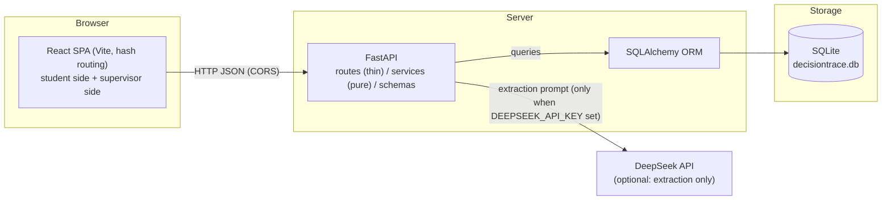

# Architecture Design

Part II design document — DecisionTrace

**Status:** Current (2026-11-19) — rewritten after the repositioning.

## 1. System Overview

DecisionTrace is a two-sided system: **one supervisor, many student
groups**. Student groups paste their meeting discussions, review what
the AI extracts, and grow decisions into discussion chains; the
supervisor reads submitted chains, annotates and decides per decision
point; approved points enter the execution phase, where the group
assigns tasks and the system keeps the order and the checks honest.

## 2. Stakeholders — Why This Shape

The instructor's review found the earlier product "too local": it did
not say clearly who it served, what it connected to, or which decisions
were worth extracting. The repositioning answers those questions with
the stakeholder table first, and the design follows from it.

| Role | Their part | What they need | Design answer |
|---|---|---|---|
| Student group member | Feeds meetings in, discusses, revises | No re-typing; the discussion must be cheaper than minutes | Intake accepts raw text (paste/import); extraction proposes decision candidates with source sentences; per-maker colors + "review mine" |
| Student group (as a team) | Evolves one topic's decision over time | Revisions must not erase history; discussion must live under the decision it concerns | The decision chain: nodes = decision versions, each node carries its own thread; appending a node keeps every earlier node |
| Supervisor | Supervises many groups, must judge what was decided and why | See the whole submitted chain, not a title card; act on any point, not just the last | Awaiting view renders chains inline (nodes + threads + annotations); annotate/approve/hold/reject per node |
| Supervisor (the chooser) | Selects which decision point the group executes | The choice must be explicit and final | Approval is a selection: at most one approved point per chain; choosing one overrules the others; the chain locks |
| Executing member | Turns the approved decision into tasks | Only approved work exists; order and problems must be visible | Execution phase per approved decision: tasks, topological order, AI checks (cycle / blocked / out-of-order) |
| Absent member / new joiner | Catches up | What was decided, why, and what the supervisor said | Chain history with per-node threads, verdict chips, supervisor annotations |

**Which decisions are worth extracting?** Named-person decision
sentences (EN + ZH patterns) and explicit collective decisions ("we
decided…" / "我们决定…"). The gate is human: candidates carry the exact
source sentence, and nothing becomes a record without confirmation.

**What connects to what?** A decision point belongs to a chain; a chain
belongs to a project (group); a thread and an annotation belong to a
decision point; a task belongs to an approved decision point. A free
decision (no chain yet) is the drafting state: it becomes supervised —
and only then approvable — once a chain is started from it. The
supervisor's dashboard groups by project — the one-to-many relation is
the backbone of every view.

## 3. Layer Responsibilities

| Layer | Location | Responsibility |
|---|---|---|
| Views | `frontend/src/` | One React app, nine views in three nav groups (SUPERVISOR / DECIDE / EXECUTE). Components in `components/`, the view registry in `views.js`, project-scoped numbering in `decisionNumbers.js`. |
| Routes | `backend/app/routes/` | One router per entity: projects, discussions, candidates, decisions, chains, commitments. HTTP concerns only. |
| Services | `backend/app/services/` | Pure functions: extraction, graph analysis (topological sort, cycles, node states, checks), importing, pagination. No HTTP objects. |
| Schemas | `backend/app/schemas/` | Pydantic request/response models; the shared `Page[T]` envelope. |
| Models | `backend/app/models/` | SQLAlchemy tables, imported by `main.py` for `create_all`. |
| Data | `backend/decisiontrace.db` | SQLite; `seed_demo.py` rebuilds the demo state and refreshes `decisiontrace.pristine.db`. |

## 4. Key Architectural Decisions

| # | Decision | Rationale |
|---|---|---|
| A1 | SQLite instead of a server database | Zero setup for demo and teammates; plain SQLAlchemy means a later PostgreSQL migration changes only the connection string. |
| A2 | AI output is always a *candidate* | Extraction can never create authoritative records; a human confirms, edits, or rejects. The trust boundary is explicit (`candidates.status`). |
| A3 | Rule-based extraction by default; DeepSeek LLM only when `DEEPSEEK_API_KEY` is set, falling back to rules on failure | The demo always works offline; the LLM is an upgrade, not a dependency. |
| A4 | Offset pagination with a shared envelope | One client contract (`usePagedList`) for every list. |
| A5 | Every edit is audited; the history is append-only | `PATCH` updates the current record in place and appends an old→new pair to `decision_history` / `commitment_history` with a reason; the audit trail is never rewritten; delete endpoints cascade dependents. |
| A6 | Hash-based view routing | The sidebar, URL and back button stay in agreement. |
| A7 | Projects are first-class; every view is project-scoped | The one-to-many supervisor/group relation is the backbone; the supervisor's dashboard groups by project. |
| A8 | Derived values are computed on read, never stored | Chain status, node states, topological order, cycles and checks all derive from the current records — no caches to drift. |
| A9 | Automation-first intake; manual forms are the fallback | Pasting a meeting is cheaper than minutes; the review queue shows every candidate with its source sentence, per-maker colors and a "review only mine" filter, so each member verifies their own statements. |
| A10 | The discussion text is the system of record | Every decision links to its source discussion; the trace is a derived view over the text. |
| A11 | **The decision chain replaces the single record** | One topic = one chain; revisions are new nodes, history is preserved; per-node threads keep the reasoning under the decision it reasons about. A decision may start free-standing — a *free decision*, the drafting state — and enters supervised life when a chain is started from it. This is the structural answer to "recording conclusions throws away the reasoning". |
| A12 | **Approval is a selection, per decision point** | The supervisor may approve any point, not necessarily the newest; choosing one overrules the chain's other pending/held points (they become `REJECTED`; never-submitted points stay untouched drafts), and an approved chain locks against further revisions. One chain has at most one executing decision — conflicting points can never both run. |
| A13 | **Execution follows approval, never precedes it** | Tasks bind to an approved decision point; the backend refuses tasks elsewhere. The supervisor watches the same boards read-only. |
| A14 | **The supervisor acts inline, not through a form** | The awaiting view renders the whole chain — nodes, threads, annotations — and the verdict/annotation bar sits under each node, so annotating "this decision" is one click, not a navigation. |
| A15 | **Display numbering is project-scoped** | Chains are `#1..#N`, nodes render `#chain-node`, free decisions `#1..#M`; chains and free decisions share the numbering but appear in different lists (chain view vs decisions view), so a bare `#N` is unambiguous in its view; global database ids never surface. Numbers restart per project so the second group reads `#1`, not `#7`. |
| A16 | Bilingual UI (中文/EN) with persisted preference | Team and course audience are Chinese-speaking; demo readability. |
| A17 | The seed script is a full scenario, not fixtures | Two groups, three weeks, every state (approved+executing with a revision awaiting choice, held, submitted, drafts EN+ZH, two pending candidates from two makers) — one command rebuilds the demo and its pristine backup. |
| A18 | Post-repositioning sweep: dead features are deleted, not kept around | The argument/deliberation layer, snapshots, impact/what-if previews, decision health, the pre-check gate, the reversal trace (the `superseded_by` column stays only for pre-repositioning rows), the stakeholder view, batch confirmation, meeting summaries, overdue highlighting and the old plan page were replaced by the supervisor/chain/execution model; their models, routes, services and i18n keys were removed so the code and the docs describe the same system. The full per-feature inventory is changelog C26. |

## 5. Automation: Reducing Manual Effort

The human's job is verifying, not transcribing. Extraction proposes
decision candidates with the exact source sentence; the review queue
shows them per maker with color coding and a "review only mine" filter,
so each member verifies their own statements. The supervisor side is
automated differently: nothing is extracted for them — they read
submitted chains, and every insight they need (status, discussions,
annotations) is laid out inline.

### Is the system agentic?

Partially, and the boundary is deliberate. DecisionTrace is
AI-assisted, not agentic: the AI component is the extraction pipeline
(rules first, optional LLM) plus the computed checks — it proposes
and it observes, but it never acts on records. The agent-specific
concerns the assignment names map onto this smaller surface:

- **Agent roles** — two roles: a *candidate proposer* for decision
  extraction, and a *checker* computed on read (cycles, blockers,
  ordering).
- **Tool interfaces** — none: the pipeline has no external tools to
  call; its only output is candidates.
- **Memory and state** — no learned state: every run reads the
  current records and the source text; nothing is cached that could
  drift (A8).
- **Orchestration** — none needed: one request, one pass.
- **Guardrails** — the central one: **the human gate (A2)**. AI
  output is always a candidate with the source sentence; a human
  confirms, edits or rejects. The LLM path additionally falls back to
  rules on any failure (A3), so the guardrail cannot be bypassed by
  an outage.

Part III keeps the same boundary while prototyping: the adoption rule
in the evaluation protocol admits the LLM only on measured evidence.

## 6. The Chain Layer (replaces the former deliberation layer)

The pre-repositioning system recorded arguments (FOR/AGAINST) as
first-class records and computed "contested" states. The repositioning
found a better carrier for the same insight: the discussion lives in
the chain, under the decision point it reasons about, in chat form —
the debate is readable where it happened, not in a parallel ledger.
The supervisor's annotations and per-point verdicts are the resolution
mechanism: a held point asks for more discussion, a rejected point is
the record of a dissent that won (or lost, when overruled by another
point's approval).

## 7. Technology and Deployment Architecture

**Technology.** Backend: FastAPI (Python) + SQLAlchemy ORM over
SQLite; Pydantic schemas; pytest-style `unittest` suite. Frontend:
React (Vite) with hash routing, a flat-key i18n layer (EN/ZH), and
Playwright driving the end-to-end verification. Optional external
service: the DeepSeek chat API, used only for the LLM extraction path.

*Alternatives considered:* PostgreSQL instead of SQLite (A1 — rejected
for zero-setup); a component library for the UI (rejected — the
product is a small set of bespoke views, a design system would be
heavier than the views); a Python web framework other than FastAPI
(rejected — FastAPI's Pydantic-native validation matches the
schema-first API).

**Deployment (development).** Local only: FastAPI on
`127.0.0.1:8000`, the SPA on `localhost:5173`, CORS for that origin.
The demo database is curated; verification and testing run against a
temp copy so the demo state survives. A class presentation runs from
this same setup — no server or account anywhere.

## 8. Security & Integrity Notes

- No authentication in this milestone (course scope); the two-sided
  split is a UX/role split, not an authorization boundary yet.
- Append-only histories and derived states (A8) keep the trace
  self-consistent; the execution checks (blocked / out-of-order, plus
  a defensive cycle check) run on every read against the current
  edges. Task edges ship with the demo data (acyclic) — dependency
  creation/removal endpoints were dropped in the repositioning
  cleanup and are a Part III item; when they return, cycle refusal
  before storage applies again (see open issues).
- The optional LLM path sends only the discussion text and never runs
  without the key; rules are the fallback (A3).

## 9. Quality Attributes

- **Usability first**: review-mine filter, inline chain review,
  per-node actions, per-group dashboards.
- **Consistency by construction**: one approved point per chain,
  locked chains, task refusal outside approved points — enforced by
  the backend, not the UI.
- **Explainability**: every record carries its source sentence; every
  check names the tasks and edges it cites.
- **Honesty in demo**: the seed data shows realistic states including
  a held-and-revised chain and an out-of-order task.

## 10. Evaluation Plan

The evaluation protocol document
(`docs/design/evaluation-protocol.md`) defines Part III's measurement
of the extraction pipeline: precision/recall per entity, an error
taxonomy, a blind rules-vs-LLM comparison with a pre-fixed adoption
rule, and an end-to-end comparison against hand-written minutes. The
rest of the system is deterministic (rules + computed-on-read views),
so the pipeline is the only part that still needs proving.

## 11. Open Issues & Risks (to test in Part III)

See `docs/design/open-issues.md`. Part III headlines: R1 no
authentication yet; R2 no formal status-transition matrix; R3 the LLM
extraction path unmeasured until the Part III protocol runs; R4 the
chain lock is one-way; R5.5 dependency edge creation/removal to
restore, with cycle refusal before storage; R7 held/rejected chains
stay in the awaiting queue. The full table (also R5, R6, O1, O2 and
the issue log I1–I7) lives in that document.
