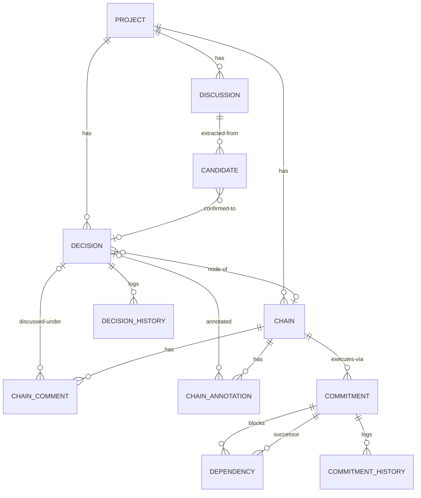

# Data Model Design

Part II design document — DecisionTrace

**Status:** Current (matches the implementation, 2026-11-19)

## 1. Entity-Relationship Diagram

## 2. Core Entities

### Project (the student group)

`id, name, description` — the supervisor supervises many projects; every
view on the supervisor side groups by project.

### Discussion (the source text)

`id, project_id, title, content, created_at` — pasted or imported meeting
text. The system of record: every decision links back to its source
discussion.

### Candidate (the AI's proposal, before the human gate)

`id, project_id, discussion_id, candidate_type, payload (JSON), source_text, status (PENDING/CONFIRMED/REJECTED), review_comment, created_at`

`candidate_type` is `DECISION` only: the repositioned system extracts
decisions; tasks come from the chain discussion, not extraction.

### Decision (one decision point)

`id, project_id, source_discussion_id, title, rationale, decided_by, status (CONFIRMED/SUPERSEDED/REVOKED), superseded_by_decision_id, chain_id, created_at`

- `decided_by` — named-person patterns (EN + ZH); team decisions stay
  null. Per-maker color coding and the "review only mine" filter hang on
  this field.
- `chain_id` — a decision either stands alone (*free decision*, the
  drafting state before supervision) or is a node of one chain. Only
  chain points are submitted and can be approved; starting a chain from
  a free decision is the step that brings it under supervision.
- **`teacher_status`** — the supervisor's verdict on this point:
  `null` (no verdict), `PENDING` (submitted, awaiting), `APPROVED`
  (the selected point — it enters execution), `HELD`, `REJECTED`
  (overruled by the approval of another point). Students never write it.
- `superseded_by_decision_id` — kept in the schema for rows created
  before the repositioning; the current system never writes it (the
  chain itself is the revision relationship).

### Chain (one topic's decision history)

`id, project_id, title, submitted_at, created_at`

`teacher_status` is **derived on read, never stored**:
- `APPROVED` — some node is approved (the supervisor chose it);
- `PENDING` — submitted but no approval yet. This includes chains whose
  nodes all carry `HELD`/`REJECTED` verdicts: they stay in the awaiting
  queue until the group appends a revision and re-submits
  (re-submission is allowed — the chain is never frozen before approval);
- `null` — a draft in discussion.

Invariants:
1. A chain has at most one approved node. Approving a node sets the
   chain's other `PENDING`/`HELD` nodes to `REJECTED`; never-submitted
   points stay untouched drafts. An approved chain refuses further
   verdicts — the verdict is final (pure annotations stay allowed).
2. An approved chain is locked: no further nodes can be appended.

### ChainComment (the discussion under one node)

`id, chain_id, decision_id, author, text, created_at` — chat-style. Each
node carries its own thread (`decision_id` is the anchor).

### ChainAnnotation (the supervisor's notes)

`id, chain_id, decision_id (nullable), text, created_at` — annotations
may target any decision point of the chain (`decision_id`) or the chain
as a whole (null).

### Commitment (a task from the execution phase)

`id, project_id, chain_id, decision_id, owner, description, due_date, status (OPEN/IN_PROGRESS/COMPLETED/DELAYED/BLOCKED)`

Tasks exist only for an **approved** decision; `decision_id` is the
anchor, `chain_id` keeps the provenance.

### Dependency

`id, project_id, predecessor_commitment_id, successor_commitment_id, dependency_type (BLOCKS)` — read-only in the current milestone: edges come from the demo data, and the execution checks (cycle / blocked / out-of-order) run against them on every read. Create/remove endpoints were removed in the repositioning cleanup (open issue).

### History tables (append-only)

- `CommitmentHistory` — status changes with reason and timestamp.
- `DecisionHistory` — title/status/rationale changes with reason.

## 3. Derived, Never Stored

- **Node state** (`WAITING` / `READY` / `BLOCKED` / `DONE` / `CYCLIC`) —
  computed from the dependency edges and statuses. The mapping from the
  stored `Commitment.status` vocabulary to the derived node state:

  | Stored status (own or predecessors') | Derived node state |
  |---|---|
  | on a dependency cycle | `CYCLIC` |
  | own status `COMPLETED` | `DONE` |
  | a predecessor is `DELAYED`/`BLOCKED` | `BLOCKED` |
  | own status `DELAYED`/`BLOCKED` (no such predecessor) | stored status shown as-is; the derived state stays `READY` |
  | predecessors exist, none done, none risky | `WAITING` |
  | nothing stands in the way | `READY` |

  Precedence: `CYCLIC` wins over everything (a completed task on a
  cycle is still `CYCLIC`); `DONE` wins over `BLOCKED` (a completed
  task is done even when a delayed predecessor exists). A task marked
  `BLOCKED` by its owner blocks its successors, not itself — its own
  stored status is displayed next to the derived state, never replaced
  by it: the execution board renders both values side by side, so an
  owner's `BLOCKED` marking is never hidden.
- **Topological order, cycles** — computed from the edges.
- **AI checks** — cycle / blocked-chain / out-of-order, computed on
  read.
- **Chain status** — derived from the nodes' verdicts (see above).
- **Display numbering** — project-scoped: chains are `#1..#N` by their
  first decision's time, nodes render `#chain-node` (`#1-2`), free
  decisions `#1..#M`. Global database ids never appear in the UI.

## 4. What Was Removed

The repositioning deleted the `Argument`, `Snapshot` and `Impact`
concepts (and their tables). The health metrics, pre-check gate,
reversal trace, stakeholder view, batch confirmation and meeting
summaries had no dedicated tables and were removed with their
endpoints and UI. The complete per-feature inventory is changelog C26;
the supervisor/chain/execution model replaced the deliberation layer,
and the chain itself is the meeting artifact — no graph snapshots.
