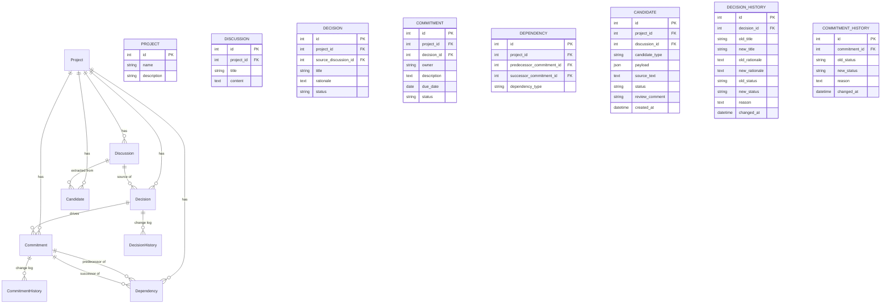

# Data Model Design

Part II design document — DecisionTrace

**Status:** Draft for team review (2026-11-04)

The core idea is four concepts — **Decision, Commitment, Dependency,
Change** — plus the intake pipeline around them (Discussion → Candidate).
History tables make change a first-class citizen: nothing is edited in
place, every modification appends a row.

## 1. Entity-Relationship Diagram

## 2. Table Notes

### Project
The workspace. The frontend keeps the active project in `localStorage`
(`decisiontrace.activeProjectId`) and reloads the dashboard on switch.
Deleting a project cascades through every child table (children first:
histories, edges, then records).

### Discussion
Raw meeting notes or chat transcripts (UC01), entered by paste or
`.txt`/`.md` upload (decoded UTF-8 first, GBK fallback — the team's
notes are mixed). Discussions are the *source context* every authoritative
record points back to.

### Decision
A decision with its rationale — the recorded *decision goal* (UC04).
`source_discussion_id` is nullable: a decision can be created directly,
not only extracted. If its source discussion is deleted, the pointer is
cleared and the decision stays. Rationale is optional on creation but is
displayed wherever the decision appears; revisions write the old and the
new rationale to `decision_history`, so the goal's evolution is preserved.

**Status:** `CONFIRMED` | `SUPERSEDED` | `REVOKED`

### Commitment
Who promised what, by when (UC05). `due_date` is informational; overdue
highlighting is a future feature.

**Status:** `OPEN` | `IN_PROGRESS` | `COMPLETED` | `DELAYED` | `BLOCKED`

### Dependency
A directed edge between two commitments (UC06). `dependency_type` is
`BLOCKS` today (the only semantics the graph algorithms need); the
column leaves room for other relations.

### Candidate
The AI intake pipeline (UC02/UC03). `payload` is JSON holding the
extraction result (decision fields, commitment fields, or the two
commitment owners of a dependency candidate). A candidate is the only
route to an authoritative record from text.

**Status:** `PENDING` | `CONFIRMED` | `REJECTED`

### DecisionHistory / CommitmentHistory
Append-only change logs. Every `PATCH` writes one row: old value, new
value, and a human `reason`. Audit-trail views read these newest-first.

## 3. Derived Structures (computed, never stored)

| Structure | Definition | Where computed |
|---|---|---|
| Graph | nodes = commitments, edges = dependencies | `services/graph.py` |
| Topological order | Kahn's algorithm over the graph | `services/graph.py` |
| Cycles | nodes that cannot be ordered | `services/graph.py` |
| Impact set | transitive closure over `BLOCKS` edges starting at a commitment/decision | `services/graph.py` |
| Consistency conflicts | order violations (e.g. completed before its predecessor) and duplicates | `services/consistency.py` |

They are computed on read (decision A8) so there is no cache to
invalidate when a dependency changes.
