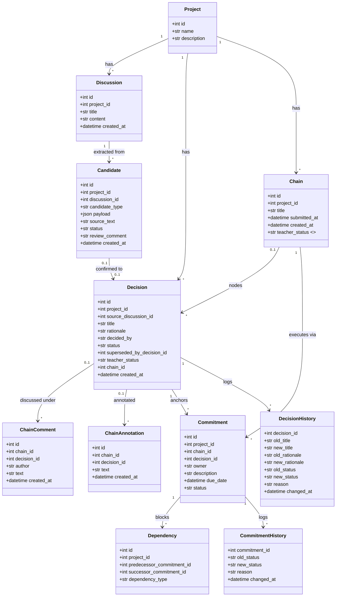
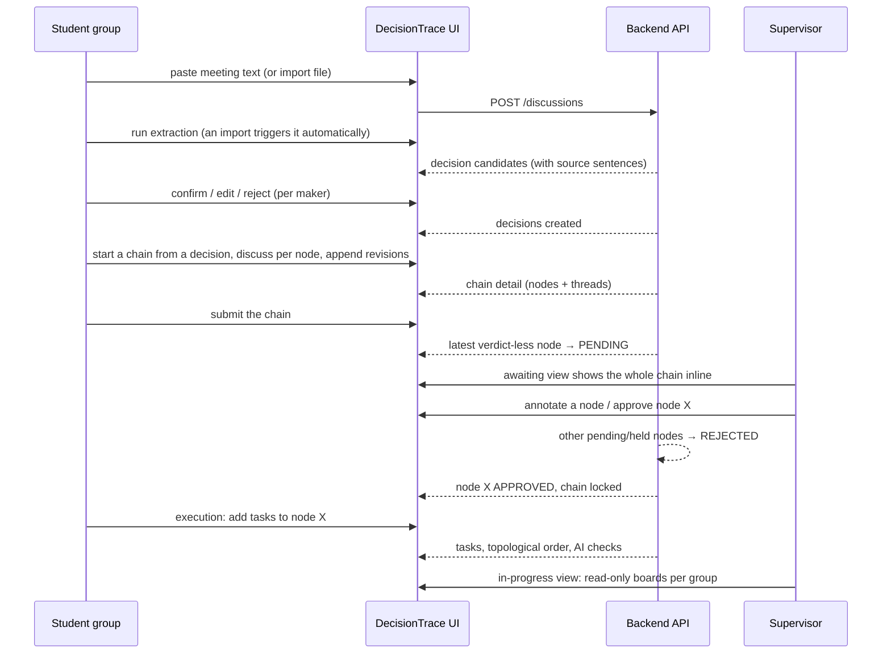
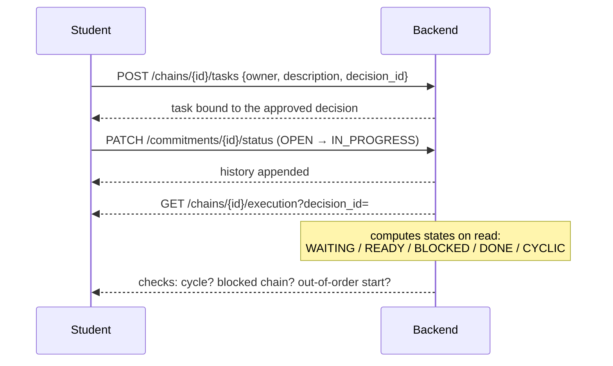

# Design Models

Part II design document — DecisionTrace

**Status:** Current (2026-11-19) — matches the repositioned system.

## 1. Class Diagram

`superseded_by_decision_id` is a legacy column: it stays in the schema
for rows created before the repositioning, and the current system never
writes it (the chain itself is the revision relationship — data-model.md).

## 2. Sequence Diagram: Discussion → Chain → Verdict → Execution

## 3. Sequence Diagram: Node States and the Out-of-Order Check

## 4. Where the Models Live

The class diagram is the SQLAlchemy models in
`backend/app/models/` (`chain.py`, `decision.py`, `commitment.py`,
`dependency.py`, `discussion.py`, `candidate.py` and the two history
tables), documented in `docs/design/data-model.md`. Derived values —
chain status, node states, topological order, checks, display
numbering — have no tables by design (A8).
