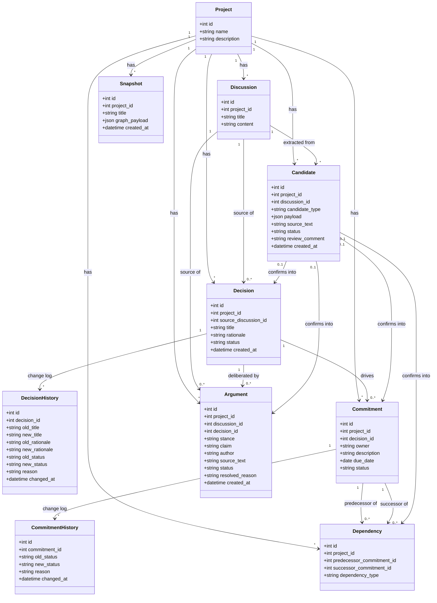
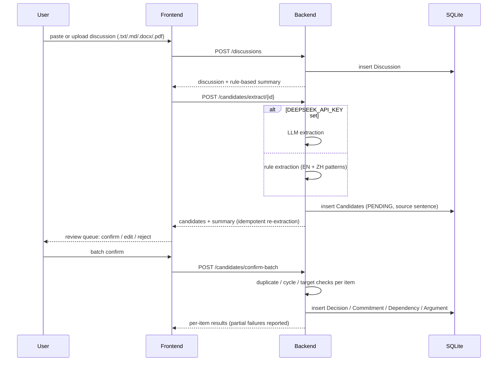
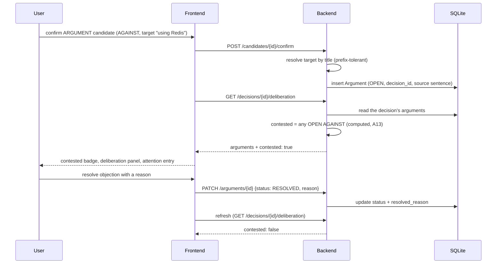
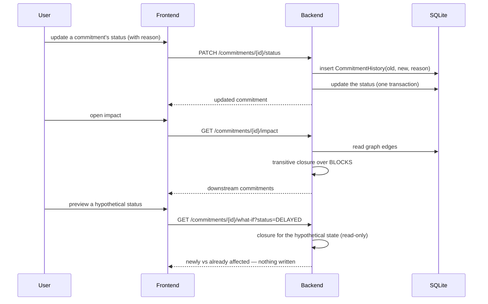

# Design Models

Part II design document — DecisionTrace

**Status:** Draft for team review (2026-11-12)

Class and interaction models of the design. The class diagram is the
implemented data model (see `data-model.md` for the ER form and table
notes); the sequence diagrams cover the three flows that carry the
product's promise: intake, deliberation, and consequence. All three are
implemented and tested; the diagrams describe what the code does, not a
wish list.

## 1. Class Diagram

Notes:

- **The candidate gate is the only route from text to authority.** Every
  record type confirms through `Candidate` (A2); the diagram shows all
  four `confirms into` edges deliberately.
- **Change is an object.** Both history classes are first-class; nothing
  is edited in place except argument resolution, which is a recorded
  state transition with a required reason (append-only argument history
  is a Part III item, risk R6).
- **`Argument.decision_id` is nullable**: a free-standing concern is a
  valid argument that no decision points to yet; it stays visible in the
  deliberation view.
- `Snapshot.graph_payload` stores the captured graph (nodes and edges)
  of one meeting; argument state in snapshots is open (R7).

## 2. Sequence Diagram: Discussion Intake and Review (UC01–UC03)

The human's job is the review step only: reading highlighted source
sentences and confirming, editing or rejecting (A9, rule 3 of §5).

## 3. Sequence Diagram: Deliberation Lifecycle

Contested is never stored: both reads compute it from the arguments, so
the badge cannot drift from the objections that justify it (§6).

## 4. Sequence Diagram: Status Change and Consequence (UC05, UC07)

History and update commit together; the what-if preview never writes a
history row, so previewing is safe (C6).

## 5. Where the Models Live

| Diagram element | Code |
|---|---|
| Classes | `backend/app/models/` (SQLAlchemy) + `backend/app/schemas/` (API shapes) |
| Extraction step | `backend/app/services/extractor.py` (rules + optional DeepSeek) |
| Contested computation | `backend/app/services/deliberation.py` |
| Closure / cycles / order | `backend/app/services/graph.py` |
| Decision health | `backend/app/services/retrospective.py` |
