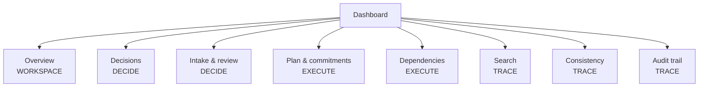

# UI Design

Part II design document — DecisionTrace

**Status:** Draft for team review (2026-11-04)

## 1. Information Architecture

Eight views, grouped in the sidebar in the order the product actually
works: what we decided → what we are doing → how we check it.

| View | Job (one job per view) | Backs use case |
|---|---|---|
| Overview | Dashboard: KPIs, graph preview, "needs attention" list | — |
| Decisions | Create/revise decisions; see rationale, history, impact | UC04, UC07 |
| Intake & review | Paste/upload discussions; review AI candidates (confirm/edit/reject) | UC01–UC03 |
| Plan & commitments | Assign and track commitments; update status with a reason | UC05 |
| Dependencies | The graph: topological layout, blocked-by, cycles, add/remove edges | UC06, UC07 |
| Search | Keyword search across records and history; hit links to its home view | UC08 |
| Consistency | Conflicts the trace cannot reconcile (order violations, duplicates) | UC07 |
| Audit trail | Status-change history per commitment, newest first | change tracking |

## 2. Shared Elements

- **Top bar** — brand, conflict chip, and the **project switcher**
  (searchable dropdown with inline create and delete-with-confirmation;
  the active project is remembered in `localStorage`).
- **Sidebar** — the view registry (`views.js`) is the single source of
  truth; a view exists in the sidebar iff it exists in the router.
- **View header** — eyebrow + title + one sentence explaining the view.
- **Pagination** — one shared component and one envelope contract
  (`usePagedList`); tertiary styling so it never competes with a
  section's primary action.
- **Status badges** — shared `StatusBadge` component; statuses render
  with the same colors everywhere (plan, graph, cycle dialog, search).

## 3. Interaction Conventions

1. **One primary action per section.** "Save discussion", "Confirm",
   "Update status". Pagination, filters, and view links stay tertiary.
2. **Navigation through the hash.** Sidebar clicks, conflict chips, and
   search hits all change `location.hash`; the sidebar state, the URL
   and the back button can never disagree.
3. **Errors say what to do next.** A dependency confirmation that fails
   because its commitments do not exist yet opens the prerequisite panel
   inline instead of leaving a bare error (CandidatesPanel).
4. **Destructive actions ask twice.** Deleting a project renders an
   inline "Delete X?" confirmation inside the switcher, never a bare ✕.
5. **AI output is visually provisional.** Candidates render in the intake
   view with type badges and a pending list; only confirmation moves a
   record into the authoritative views.
6. **Empty states are routes, not walls.** A fresh database shows the
   dashboard with a banner and a working project switcher, so the first
   project can always be created from the UI.
7. **Manual entry.** Decisions and Plan & commitments each offer an
   expandable creation form. A decision requires a title and can include
   rationale and a source discussion number. A commitment requires an
   owner and description and can include a due date and linked decision.
   Successful creation clears the form and selects the new record after
   refreshing project data. Failed submissions retain the draft. Switching
   projects resets the form and prevents late creation responses from
   changing the selection in another project.

## 4. Component Inventory

| Component | Purpose |
|---|---|
| `Sidebar` | View registry rendered as grouped navigation |
| `ProjectSwitcher` | Create/switch/delete projects, top bar |
| `DecisionCreateForm` | Manual decision creation with rationale and optional source discussion |
| `CommitmentCreateForm` | Manual commitment creation with optional due date and linked decision |
| `DiscussionsPanel` | Paste or upload discussion, trigger extraction |
| `CandidatesPanel` | Pending/reviewed candidate lists; confirm/edit/reject; prerequisite panel |
| `SearchPanel` | UC08 search form, ranked results, cross-view navigation |
| `CycleDialog` | Renders a rejected cycle (hops, removals) when adding an edge |
| `StatusBadge` | Shared status pill |
| `Pagination` | Shared pager |
| `usePagedList` | Hook: one contract for every paginated endpoint |

## 5. Mockups

See `docs/SRS/mockups/` for the SRS mockups (overview, intake,
dependencies, audit). The implemented UI matches these structurally;
screenshots of the live app can be captured with the Playwright driver
scripts used during verification.
